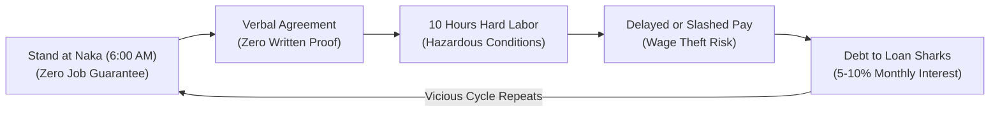
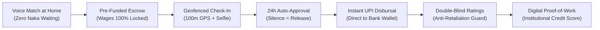
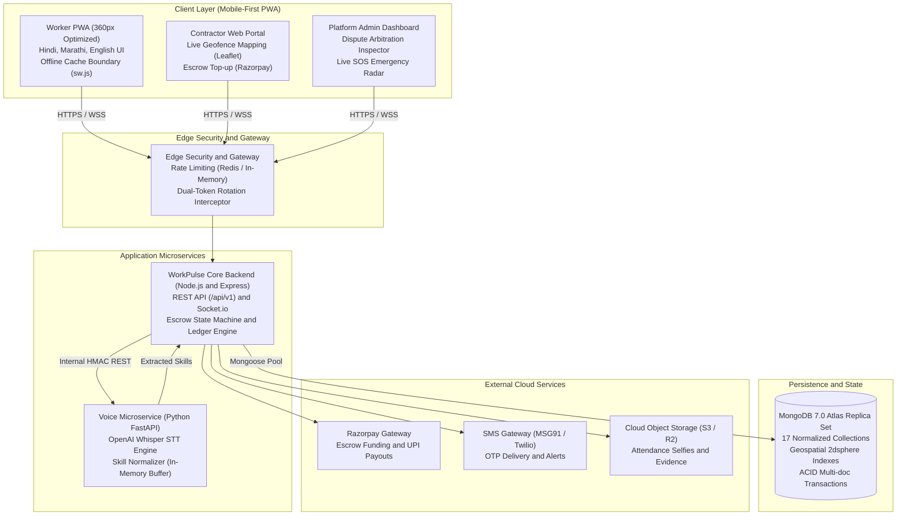
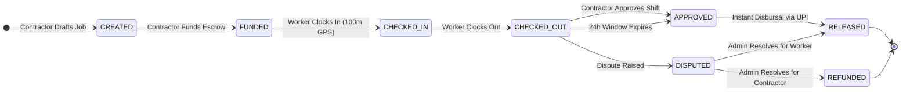

<div align="center">

<h1 align="center">⚡ WorkPulse</h1>

### *Paseena Sookhne Se Pehle, Mehnat Ka Paisa Khaate Mein.*  
**पसीना सूखने से पहले, मेहनत का पैसा सीधे खाते में।**

<p align="center">
  <b>Re-architecting trust, dignity, and financial sovereignty for India's 450M+ daily-wage & blue-collar workforce.</b><br/>
  An autonomous, zero-middleman micro-contracting platform replacing verbal exploitation with <b>Pre-Funded Escrow</b>, <b>Biometric Geofenced Proof-of-Work</b>, <b>Double-Blind Anti-Retaliation Ratings</b>, and <b>Multilingual Voice AI</b>.
</p>

<p align="center">
  <b>🛡️ 100% Pre-Funded Escrow</b> &nbsp;•&nbsp; 
  <b>⏱️ Guaranteed 24h Auto-Approval</b> &nbsp;•&nbsp; 
  <b>⚡ Instant UPI Bank Disbursal</b> &nbsp;•&nbsp; 
  <b>📍 100m Geofenced Proof-of-Work</b> &nbsp;•&nbsp; 
  <b>🎙️ Zero-Typing Voice Onboarding</b>
</p>

<br/>

<!-- 20+ Curated Shields.io Badges -->
[](https://github.com/kasimshah19/WorkPulse/releases/tag/v0.8)
[](https://github.com/kasimshah19/WorkPulse/actions)
[](LICENSE)

<br/>

[](https://nextjs.org/)
[](https://react.dev/)
[](https://tailwindcss.com/)
[](https://web.dev/progressive-web-apps/)
[](https://github.com/pmndrs/zustand)
[](https://nodejs.org/)
[](https://expressjs.com/)
[](https://socket.io/)
[](https://www.mongodb.com/)
[](https://www.python.org/)
[](https://fastapi.tiangolo.com/)
[](https://github.com/openai/whisper)
[](https://jestjs.io/)
[](https://pytest.org/)
[](https://playwright.dev/)
[](https://www.deque.com/axe/)
[](https://jwt.io/)
[](https://razorpay.com/)
[](https://www.meity.gov.in/)

</div>

---

## 🌐 Live Deployments & Cloud Topology

| Service | Platform | Environment | Live URL / Access | Security Policy |
|---|---|---|---|---|
| **Frontend Web & Mobile PWA** | **Vercel** | Production | [https://workpulse-app.vercel.app](https://workpulse-app.vercel.app) | Public HTTPS, Content Security Policy, Workbox Service Worker |
| **Core API & Real-time Socket Server** | **Render** | Production | [https://workpulse-api.onrender.com](https://workpulse-api.onrender.com) | TLS 1.3, Rate-Limited (100 req/15m), CSRF Header Protected |
| **Voice STT Microservice** | **Render / Internal** | Internal VPC | `http://voice-service:8000` | Restricted internal VPC traffic, HMAC Key authenticated |
| **Database Cluster** | **MongoDB Atlas** | Multi-Region Replica Set | `Protected Cloud Cluster` | *Credentials & raw URI redacted for security; zero public IP exposure* |

> [!NOTE]
> MongoDB database connection strings and credentials are restricted to VPC peering and encrypted environment secrets. No raw database endpoints are exposed publicly.

---

## 🎯 The Problem Statement vs. The WorkPulse Solution

### 1. The Socio-Economic & Technical Crisis in India's Unorganized Labor Sector

India has over **450 million unorganized daily-wage and blue-collar workers** (carpenters, electricians, masons, painters, plumbers, welders, tile workers, and construction laborers). Despite forming the backbone of the national infrastructure economy, this sector operates under archaic, predatory, and trust-deficient conditions.



#### 1.1 The "Labour Chowk / Naka" Inefficiency
- **The Problem**: Millions of workers assemble at roadside roundabouts ("Nakas" or "Chowks") at 6:00 AM every morning. On average, a worker spends **2 to 3 productive hours** waiting in harsh weather, competing blindly for day jobs. If unhired by 9:00 AM, the entire day’s earning capacity is destroyed (0 earning day).
- **Economic Loss**: Over 20% to 30% of a worker's monthly working days are wasted in transit and idle waiting at labor stands.

#### 1.2 The Wage Theft Epidemic & The "Ghosting" Contractor
- **The Problem**: Because work arrangements are purely verbal, contractors frequently engage in wage shaving ("I only have ₹500 today, take it or leave it") or defer wages indefinitely ("I will clear your balance next week when the client pays me"). When large commercial or residential jobs conclude, unscrupulous contractors frequently change their phone numbers, leaving workers unpaid for weeks of grueling physical labor.
- **Root Cause**: The traditional hiring model provides **zero escrow guarantees**. The worker carries 100% of the counterparty financial risk.

#### 1.3 The "Retaliatory Review" Trap in Traditional Gig Apps
- **The Problem**: Conventional gig-economy platforms (e.g. Uber, Urban Company) use instant, public single-sided rating mechanisms. If a worker refuses unpaid overtime, complains about abusive treatment, or demands fair pay, the contractor instantly awards a punitive **1-star rating**.
- **The Consequence**: Because workers fear permanent blacklisting, they are coerced into silence, enduring abuse and unpaid overtime. Traditional rating models weaponize reputation against the vulnerable party.

#### 1.4 Fake Attendance, "Buddy Punching" & Site Ghosting (The Contractor's Pain)
- **The Problem**: Contractors managing multiple job sites across cities (e.g. Pune, Bengaluru) face rampant attendance fraud. Subcontractors report 10 laborers on site when only 6 are physically present, or workers arrive 2 hours late and demand full-day wages.
- **The Consequence**: Contractors bleed capital on non-verified shifts, fostering mutual hostility and adversarial friction between management and site labor.

#### 1.5 Financial Invisibility & Exclusion from Institutional Credit
- **The Problem**: Daily wages are paid in untracked cash. Without verifiable earnings history, digital bank statements, or proof-of-work records, blue-collar workers are systematically rejected by formal banks for micro-loans, healthcare insurance, and housing credit.
- **The Trapping Cycle**: Workers are forced into the clutches of local predatory moneylenders charging usurious interest rates (60% to 120% APR).

#### 1.6 Digital & Text Illiteracy (The Software Exclusion Barrier)
- **The Problem**: Modern mobile applications are designed for educated, English-literate white-collar users. They demand complex textual inputs, multi-page resume forms, dropdown menus, and document uploads.
- **The Consequence**: Semi-literate and illiterate blue-collar workers cannot navigate complex digital interfaces, completely excluding them from the benefits of modern software platforms.

#### 1.7 Hazardous Job Sites & Complete Absence of an Emergency Safety Net
- **The Problem**: Construction scaffolding collapses, electrical arc flash burns, and trench cave-ins occur daily across unorganized job sites without on-site medical staff or emergency distress protocols. Workers trapped in high-risk incidents have no instant mechanism to alert nearby peers or emergency services.

---

### 2. How WorkPulse Solves Each Problem: The Architecture of Trust

WorkPulse fundamentally re-engineers daily-wage contracting by removing interpersonal friction and replacing verbal trust with **cryptographic, financial, and spatial guarantees**.



#### 2.1 Guaranteed Pre-Funded Daily Escrow (`ESCROW_HOLD` Engine)
- **Architectural Solution**: A contractor cannot book a worker without first locking the full day's wage into a platform escrow account via UPI/Cards (`ESCROW_HOLD`).
- **How It Works**: Before the worker boards a bus or leaves home, their phone displays a green **"Escrow Funded"** badge. The funds are legally committed in platform custody. Even if the contractor disappears, turns off their phone, or refuses to speak, the money cannot be withdrawn back by the contractor once the shift commences.

#### 2.2 The Deterministic 24-Hour Auto-Approval Engine
- **Architectural Solution**: Solves the contractor ghosting problem via automated time-based state transitions.
- **How It Works**: When a worker clocks out at shift end, an automated 24-hour countdown timer begins (`autoApprovalAt`). The contractor has a generous window to inspect the work and click "Approve". If the contractor remains silent or unresponsive for 24 hours, the backend scheduler **automatically marks the shift approved and disburses full payment to the worker's wallet**. Silence is legally and cryptographically interpreted as approval.

#### 2.3 Double-Blind Two-Way Ratings with Bayesian Smoothing ($C=3, M=4.0$)
- **Architectural Solution**: Eliminates retaliatory blacklisting by hiding ratings until both parties have submitted their honest evaluation.
- **How It Works**:
  1. Both contractor and worker are prompted to rate each other after shift completion.
  2. Each submitted rating is saved in a sealed state (`revealedAt: null`). Neither party can view the other’s score or review comments.
  3. Ratings are unblinded simultaneously **only after both parties have rated**, or after the 14-day arbitration window closes.
  4. To eliminate rating inflation or skew from small sample sizes, aggregate scores are computed via Bayesian smoothing:
     $$\text{Weighted Score} = \frac{C \times M + \sum R}{C + N} = \frac{3 \times 4.0 + \sum R}{3 + N}$$
     Workers with fewer than 3 reviews are badged as `NEW` to prevent premature penalties.

#### 2.4 Cryptographic Proof-of-Work: 100m Geofencing + Biometric Selfie
- **Architectural Solution**: Solves fake attendance and buddy-punching without requiring expensive hardware fingerprint scanners.
- **How It Works**:
  - **Spatial Validation**: The contractor defines the construction site boundary on a Leaflet map. The worker's device uses hardware GPS Geolocation. Check-in is mathematically rejected if the worker is further than **100 meters** from the designated coordinates (`GEOFENCE_EXCEEDED`).
  - **Biometric Presence**: Check-in requires a live camera selfie captured within the app, stamped with real-time GPS coordinates and UTC timestamps. The contractor receives an instant notification with the photo on their dashboard.

#### 2.5 Double-Entry Immutable Banking Ledger (Zero-Sum Invariant Engine)
- **Architectural Solution**: Built with the same mathematical rigor as core banking and clearinghouse engines.
- **How It Works**:
  - Every monetary movement is recorded as a balanced, multi-legged transaction group (`groupId`).
  - Enforces the universal zero-sum invariant:
    $$\sum_{i=1}^{n} \text{DEBIT}_i = \sum_{i=1}^{n} \text{CREDIT}_i$$
  - Continuous automated reconciliation scripts (`npm run reconcile`) verify that total gateway deposits minus total UPI payouts strictly equal total user balances plus platform fees with **zero tolerance for drift ($\Delta = 0$)**.

#### 2.6 Zero-Typing Multilingual Voice Onboarding (DPDP Act 2023 Compliant)
- **Architectural Solution**: Bridges the digital divide by allowing workers to onboard by speaking in their native tongue.
- **How It Works**:
  - Workers tap a large microphone button and speak freely in Hindi or Marathi (*"Mera naam Ramesh hai, main 6 saal se plumbing aur pipeline fitting ka kaam karta hoon"*).
  - The voice microservice uses **OpenAI Whisper STT** and specialized phonetic regex dictionaries to extract the primary trade and experience years in under 2 seconds.
  - Workers review extracted skill badges with a simple "Sahi Hai" (Correct) button.
  - **Privacy Guarantee**: Audio bytes reside exclusively in temporary RAM buffers and are never saved to disk or database, fully complying with India's Digital Personal Data Protection (DPDP) Act 2023.

#### 2.7 Emergency SOS Radar with Real-Time Multi-Tier Auto-Escalation
- **Architectural Solution**: Provides an instant physical and medical safety net on dangerous job sites.
- **How It Works**:
  - In an emergency (e.g. scaffolding collapse, physical harassment), the worker taps the large SOS button.
  - The SOS bypasses all standard GPS validation barriers (`locationFlag: MISSING/STALE`) to ensure emergency delivery.
  - The server immediately broadcasts a high-priority distress alert with live map coordinates to:
    1. All fellow workers within a 3km radius.
    2. The site contractor.
    3. Platform administrative monitors.
  - If unacknowledged within 60 seconds, background schedulers automatically escalate the distress signal to emergency phone contacts via SMS fallback with a direct Google Maps link.

#### 2.8 Direct-to-UPI Instant Bank Payouts
- **Architectural Solution**: Eliminates cash dependency and creates a formal digital financial identity.
- **How It Works**: Once a shift is approved, the worker can tap "Nikaalein" (Withdraw) to disburse earnings directly to their UPI ID (GPay, PhonePe, Paytm, BHIM) in seconds. Every completed shift generates a formal digital proof-of-work certificate, enabling workers to establish creditworthiness for institutional banking.

---

### 3. Multi-Dimensional Comparison: The Paradigm Shift

| Evaluation Metric | Traditional Informal / Naka Model | Generic Gig Apps (Urban Company, TaskRabbit) | WorkPulse Autonomous Escrow Platform |
|:---|:---|:---|:---|
| **Payment Security** | ❌ None (verbal promise; frequent wage theft) | ⚠️ Partial (delayed weekly payouts, high platform commission 20-30%) | ✅ **100% Pre-Funded Escrow** locked before shift starts; 0% worker fee |
| **Payment Timing** | ❌ Days, weeks, or ghosted | ⚠️ 3 to 7 business days payout cycle | ✅ **Instant UPI Disbursal** within minutes of shift completion |
| **Shift Approval** | ❌ At contractor's arbitrary whim | ⚠️ Customer satisfaction tickets | ✅ **Guaranteed 24h Auto-Approval**; contractor silence = automatic release |
| **Reputation System** | ❌ Word of mouth; easily poisoned by gossip | ❌ Single-sided rating trap; contractors threaten 1-star reviews | ✅ **Double-Blind Mutual Ratings** with Bayesian smoothing ($C=3, M=4.0$) |
| **Proof of Work** | ❌ Zero records; cash in hand | ⚠️ Platform proprietary internal database | ✅ **Cryptographic Geofence (100m) + Live Selfie Proof** downloadable as PDF |
| **Worker Onboarding** | ❌ Physical presence required at street chowk | ❌ Multi-page textual forms in English; resume uploads | ✅ **Multilingual Voice Onboarding (Hindi/Marathi)** with Whisper STT |
| **Safety Net** | ❌ Worker left to fend for themselves | ❌ Basic call center support ticket | ✅ **Live SOS Radar** broadcast to nearby peers + SMS auto-escalation |
| **Financial Ledger** | ❌ Paper diary or memory; discrepancies frequent | ⚠️ Black-box database records | ✅ **Banking-Grade Double-Entry Ledger** with automated reconciliation |
| **Accessibility** | ❌ Dependent on physical location | ❌ Demands high-speed smartphone & English literacy | ✅ **PWA (360px optimized)**, offline banner, low-bandwidth audio buffers |

---

## 🏗️ System Architecture & Data Flow



---

## ⚙️ Core Technical Features

### 1. Escrow State Machine & Double-Entry Ledger
Financial safety is the foundation of WorkPulse. Money never moves without an immutable ledger entry.



- **Zero-Sum Ledger**: Every transaction requires a `groupId`. Debits must strictly equal credits ($\sum \text{Debit} = \sum \text{Credit}$).
- **Automated Mathematical Reconciliation (`npm run reconcile`)**: Continuously verifies Invariants A through E across all system wallets, held escrows, and gateway transactions.

### 2. Dual-Token Rotation & Session Security (Phase 8 Hardened)
- **15-Minute Access Token**: Kept purely in client memory (`authStore.js`).
- **7-Day Sliding Refresh Token**: Stored in a strict `httpOnly`, `sameSite: 'lax'`, `path: '/api/v1/auth'` cookie and hashed (SHA-256) in MongoDB `refreshtokens` collection.
- **Family Hijacking Detection**: Replaying an expired or already-rotated token immediately triggers security revocation across all active devices for that user.
- **Production Guard Rails**: Server throws a fatal startup error if `NODE_ENV=production` is launched with dev OTP bypasses or default secret keys.

### 3. Voice Onboarding & DPDP Compliance
- **Hindi & Marathi Trade Extraction**: Workers speak their trade ("Main 5 saal se bijli ka kaam karta hoon"). The audio buffer is transcribed via OpenAI Whisper and classified into 9 standardized trades.
- **Privacy First (DPDP Act 2023)**: Audio bytes are processed in memory and never written to disk or database. Session metadata auto-expires in 90 days via MongoDB TTL.
- **Guaranteed Fallback**: If microphone permission is denied or voice service is offline, a 16-skill icon grid engages instantly.

### 4. Emergency SOS & Volunteer Safety Radar
- **Instant Distress Broadcast**: Workers tap the emergency SOS button to broadcast their location to nearby workers, contractors, and platform admins via Socket.io.
- **Fault-Tolerant Execution**: Emergency SOS bypasses geofencing checks (`locationFlag: MISSING/STALE`) with 120-second client-side UUID deduplication and automatic `tel:112` / `sms:` fallback links.
- **Automated Multi-Tier Escalation**: Background schedulers escalate unacknowledged emergencies from nearby peers (Tier 1) to platform admins and emergency contacts (Tier 2).

---

## 🧰 Technology Stack Matrix

| Layer | Technology | Version | Purpose |
|---|---|---|---|
| **Frontend Framework** | **Next.js** | `v14.2.15` | App Router, Server Components, Route Handlers |
| **UI Library** | **React** | `v18.3.1` | Concurrent rendering, dynamic hooks |
| **Styling & Icons** | **Tailwind CSS + Lucide** | `v3.4.14` | Mobile-first 360px responsive design system |
| **Offline Engine** | **next-pwa (Workbox)** | `v5.6.0` | Service worker shell caching, network-only financial boundary |
| **Mapping & GPS** | **Leaflet + React-Leaflet** | `v1.9.4` | Interactive geofencing, site pinpoints, SOS radar |
| **State Management** | **Zustand** | `v4.5.5` | In-memory token store, language selector, session state |
| **Backend Runtime** | **Node.js** | `v20.x LTS` | High-performance asynchronous event loop |
| **REST Server** | **Express** | `v4.21.0` | Modular middleware, route controllers, validation pipeline |
| **Real-time Engine** | **Socket.io** | `v4.7.5` | WebSockets, bidirectional alerts, attendance pulses |
| **Database ODM** | **Mongoose** | `v8.7.0` | Multi-document ACID transactions, schema enforcement |
| **Database Engine** | **MongoDB Atlas** | `v7.0` | 17 normalized collections, 2dsphere spatial indexes |
| **Voice Framework** | **Python / FastAPI** | `v3.11+ / v0.115` | High-speed async audio streaming & STT dispatch |
| **STT Engine** | **OpenAI Whisper** | `base / v3` | Multilingual Hindi, Marathi, and Hinglish speech recognition |
| **Security & Cryptography** | **bcryptjs + crypto** | `v2.4.3` | Password hashing, SHA-256 session token hashing |
| **Input Validation** | **Joi** | `v17.13.3` | Schema validation, stripUnknown, coordinate bounds checking |
| **Test Runners** | **Jest + Pytest + Playwright** | `Latest` | Unit, integration, chaos simulation, and e2e testing |

---

## 📂 Repository Structure

```
WorkPulse/
├── .github/
│   └── workflows/
│       └── ci.yml                 # Multi-stage GitHub Actions CI (MongoDB RS, Pytest, Next build)
├── frontend/                      # Next.js 14 Mobile-First Progressive Web App
│   ├── public/                    # PWA Manifest, icons, service worker (sw.js)
│   ├── src/
│   │   ├── app/                   # App Router (Worker, Contractor, Admin, Auth, Dev)
│   │   ├── components/            # Reusable UI widgets, OfflineBanner, MapPicker
│   │   ├── lib/                   # API axios client with refresh queue, socket.io client
│   │   └── store/                 # Zustand in-memory auth & application stores
│   ├── e2e/                       # Playwright E2E & @axe-core accessibility test suites
│   ├── next.config.js             # PWA runtime caching policies & security headers
│   └── package.json
├── backend/                       # Node.js + Express REST & Socket.io Core Engine
│   ├── src/
│   │   ├── config/                # Environment assertions, constants, database connection
│   │   ├── controllers/           # Auth, Jobs, Attendance, Escrow, Wallet, Safety, Admin
│   │   ├── middleware/            # JWT auth, dual-token guard, RBAC, Rate limiter, Joi validation
│   │   ├── models/                # 17 Mongoose schemas (User, Escrow, Ledger, RefreshToken...)
│   │   ├── routes/                # Express router endpoints
│   │   ├── schedulers/            # 24h Escrow auto-approval, Attendance auto-checkout, SOS
│   │   ├── scripts/               # Chaos simulation, Explain query audits, Demo seeders
│   │   ├── services/              # Double-entry ledger, Escrow state machine, Ratings, Sessions
│   │   └── sockets/               # Real-time event rooms and push broadcasts
│   ├── tests/                     # 12 Jest suites (Authz matrix, Lifecycle, Chaos simulation)
│   └── package.json
├── voice-service/                 # Python 3.11 FastAPI Voice STT Microservice
│   ├── app/
│   │   ├── core/                  # Service configuration, API keys, CORS
│   │   ├── routers/               # /transcribe, /extract, /health endpoints
│   │   └── services/              # Skill extractor, normalizer, Whisper STT integration
│   ├── tests/                     # Pytest suite (health, regex extractor, dummy wavs)
│   └── requirements.txt
└── docs/                          # Comprehensive Engineering & Architecture Documentation
    ├── architecture.md            # System architecture, monorepo topology, sequence diagrams
    ├── api-contract.md            # Complete REST & Socket.io API contract
    ├── db-schema.md               # 17 Collection data models & indexing strategies
    ├── escrow-state-machine.md    # Financial state machine & dispute arbitration logic
    ├── flow-validation.md         # 11 User journeys mapped end-to-end
    ├── testing.md                 # Test suite metrics, chaos simulation report, reconciliation
    ├── security.md                # Threat models, token rotation, production safety barriers
    └── pwa.md                     # Caching strategy matrix and offline resiliency
```

---

## ⚡ Quickstart & Local Setup

### Prerequisites
- **Node.js**: `v20.x LTS` or higher
- **Python**: `v3.11` or higher
- **MongoDB**: `v7.0` (Local replica set or MongoDB Atlas)
- **Git**

### 1. Clone Repository
```bash
git clone https://github.com/kasimshah19/WorkPulse.git
cd WorkPulse
```

### 2. Configure Environment Files
```bash
# Backend configuration
cp backend/.env.example backend/.env

# Voice service configuration
cp voice-service/.env.example voice-service/.env

# Frontend configuration
cp frontend/.env.example frontend/.env.local
```

### 3. Setup Backend
```bash
cd backend
npm install

# Seed realistic demo database (1 Admin, 5 Contractors, 15 Workers across 6 job stages)
npm run demo:reset

# Verify double-entry ledger balance
npm run reconcile

# Start local API & Socket server
npm run dev
# Running on http://localhost:5000
```

### 4. Setup Voice Microservice
```bash
cd ../voice-service

# Create virtual environment
python -m venv venv

# Windows
.\venv\Scripts\activate
# Linux/macOS: source venv/bin/activate

pip install -r requirements.txt
uvicorn app.main:app --host 0.0.0.0 --port 8000 --reload
# Running on http://localhost:8000
```

### 5. Setup Frontend
```bash
cd ../frontend
npm install
npm run dev
# Running on http://localhost:3000
```

---

## 🧪 Testing & Verification Matrix

WorkPulse enforces automated verification across all layers before any code is merged:

| Test Suite | Framework / Tool | Verified Scenarios | Result | Execution Command |
|---|---|---|---|---|
| **Ledger Reconciliation** | Custom Math Engine | Invariants A through E (Sum Debit == Sum Credit, zero drift) | ✅ **PASS (diff = 0)** | `npm run reconcile` (in `backend/`) |
| **Chaos Simulation** | Stochastic Thread Pool | 2,000 concurrent actions, idempotency double-clicks, dispute races | ✅ **PASS (0 errors)** | `npm run simulate -- --seed 42` |
| **Authorization Matrix** | Jest + Supertest | 57 endpoints tested across Worker, Contractor, Admin, Anonymous | ✅ **57 / 57 PASS** | `npm test -- tests/authz.matrix.test.js` |
| **Lifecycle & Time-Travel** | Jest + Clock Utility | Onboard -> Escrow -> Geofence Check-in -> 24h Auto-Approval -> Payout | ✅ **3 / 3 PASS** | `npm test -- tests/lifecycle.test.js` |
| **Query Plan & Index Audit** | MongoDB Explain Plans | 12 core query paths audited for index utilization | ✅ **0 COLLSCAN** | `npm run audit:indexes` |
| **Voice STT Microservice** | Pytest | Hindi/Marathi phonetics, audio parsers, schema validators | ✅ **18 PASS (1 skipped)** | `python -m pytest -v` (in `voice-service/`) |
| **Accessibility & A11y** | Playwright + Axe-Core | WCAG 2.1 AA audits, 48px touch targets, color contrast ratios | ✅ **PASS** | `npm run test:e2e` (in `frontend/`) |
| **Frontend Production Build** | Next.js Compiler | 33 static pages compiled, service worker generated, zero type errors | ✅ **PASS (87.6 kB shared)** | `npm run build` (in `frontend/`) |

---

## 📋 Comprehensive API Route Overview

| Method | Endpoint | Allowed Roles | Description |
|---|---|---|---|
| `POST` | `/api/v1/auth/send-otp` | Public | Dispatches 6-digit OTP via SMS (mock/MSG91) |
| `POST` | `/api/v1/auth/verify-otp` | Public | Validates OTP; returns in-memory access token & sets refresh cookie |
| `POST` | `/api/v1/auth/refresh` | Public | Rotates refresh token and issues fresh 15-minute access token |
| `POST` | `/api/v1/auth/logout` | Authenticated | Revokes current refresh token family and clears session cookie |
| `GET` | `/api/v1/users/me` | Authenticated | Fetches profile, role, KYC status, and wallet summary |
| `POST` | `/api/v1/voice/onboard` | Worker | Streams voice audio to Whisper STT for trade extraction |
| `POST` | `/api/v1/voice/confirm` | Worker | Commits reviewed trades and experience to worker profile |
| `POST` | `/api/v1/jobs` | Contractor | Creates a new micro-contracting job opening |
| `GET` | `/api/v1/jobs/nearby` | Worker | Finds open jobs matching worker skills within configured radius |
| `POST` | `/api/v1/escrow/jobs/:id/fund` | Contractor | Locks daily shift wages into escrow from contractor wallet |
| `POST` | `/api/v1/attendance/check-in` | Worker | Validates 100m GPS geofence and stores proof-of-work selfie |
| `POST` | `/api/v1/attendance/check-out` | Worker | Completes shift, calculates hours, and initiates signoff timer |
| `POST` | `/api/v1/attendance/:id/signoff` | Contractor | Approves shift attendance and triggers immediate escrow release |
| `POST` | `/api/v1/wallet/withdraw` | Worker | Disburses wallet balance directly to worker UPI ID |
| `POST` | `/api/v1/ratings` | All | Submits double-blind counterparty review |
| `POST` | `/api/v1/incidents/sos` | Worker | Triggers emergency distress alert with real-time GPS updates |
| `POST` | `/api/v1/admin/disputes/:id/resolve` | Admin | Arbitrates disputed escrow (Full Release, Refund, or Split) |
| `GET` | `/api/v1/admin/reconciliation` | Admin | Returns real-time mathematical ledger health audit |

---

## 👥 Demo Credentials

For testing and demonstration, use the automated seeder (`npm run seed:demo`):

| Role | Name | Phone Number | Credentials / Notes |
|---|---|---|---|
| **Platform Admin** | Platform Admin | `+919000000900` | Full administrative, arbitration, and ledger access |
| **Contractor** | Sharma Electricals | `+919000000101` | Pre-funded wallet balance: ₹50,000 |
| **Contractor** | Verma Construction | `+919000000102` | Pre-funded wallet balance: ₹50,000 |
| **Worker (Electrician)** | Suresh Electrician | `+919000000001` | UPI: `suresh@okhdfcbank` |
| **Worker (Mason)** | Bablu Rajmistri | `+919000000003` | UPI: `bablu@okaxis` |
| **Worker (Painter)** | Raju Painter | `+919000000005` | Shift in-progress demo user |

*(In development mode, OTP is fixed to `123456` or bypassable via `/api/v1/auth/dev-login`)*

---

## 📄 License & Attribution

This project is licensed under the **MIT License** — see the [LICENSE](LICENSE) file for details.  
Copyright © 2026 Kasim Shah & WorkPulse Contributors. All rights reserved.
