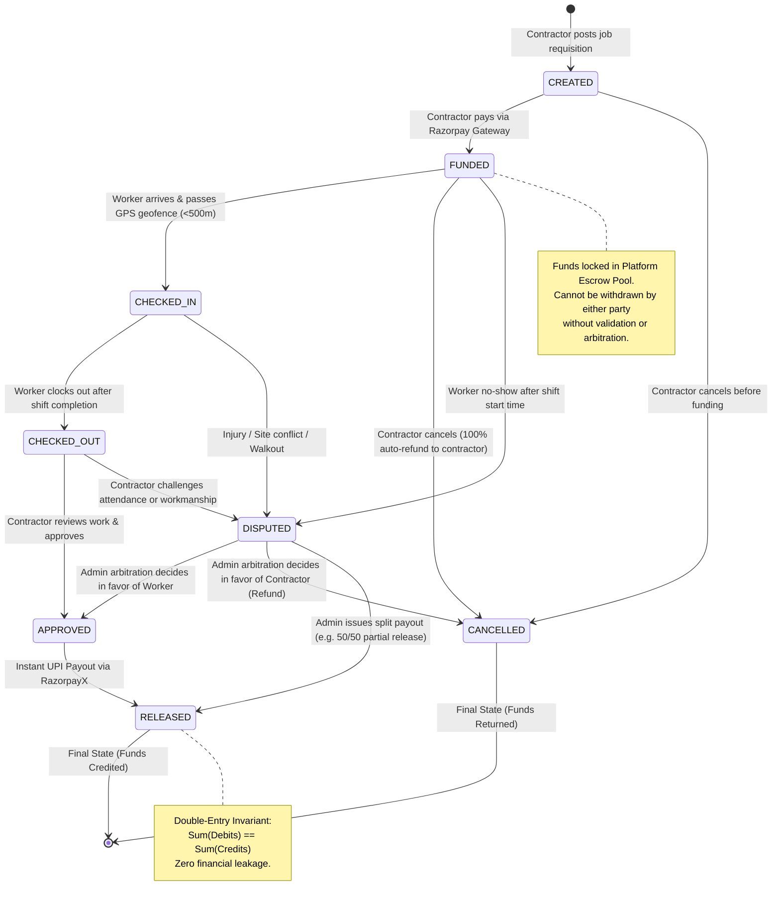
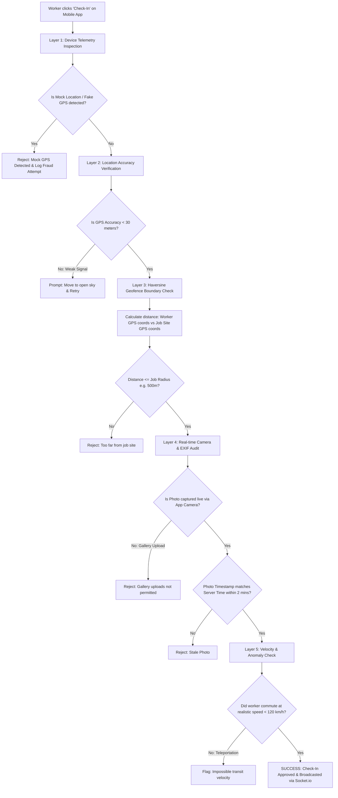
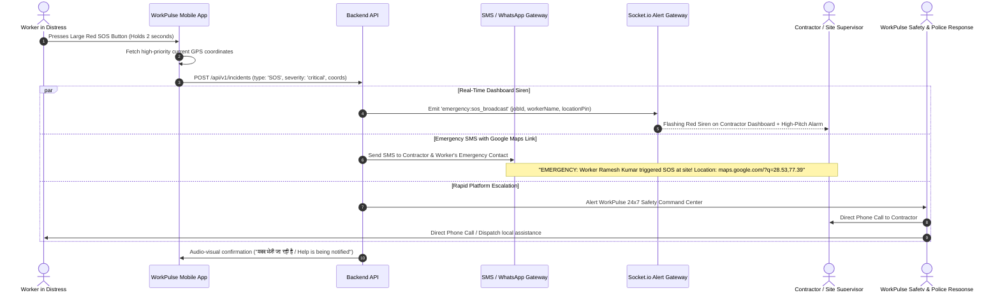
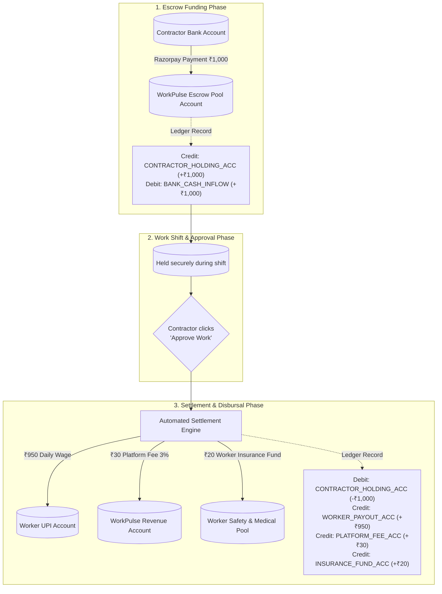
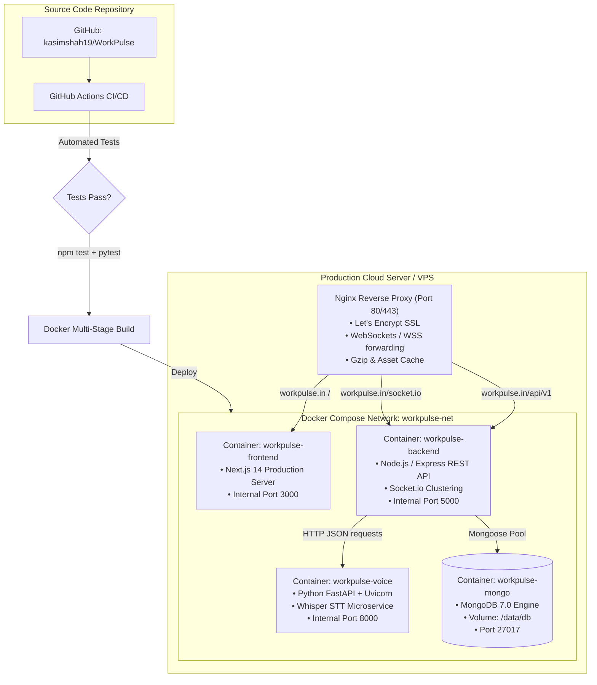

# WorkPulse – Advanced Engineering & Security Diagrams

This document contains 6 critical engineering diagrams for the WorkPulse platform, covering financial invariants, anti-fraud geofencing, emergency SOS routing, double-entry ledger settlement, low-literacy onboarding, and production deployment topology.

---

## 1. Escrow State Machine & Financial Invariants

WorkPulse uses a deterministic finite-state automaton (FSA) for escrow transactions. Every state transition is mathematically verified against strict actor permissions and produces an immutable double-entry ledger event.

---

## 2. Geo-Fencing & Anti-Spoofing Security Verification Pipeline

To protect contractors from proxy attendance and fake check-ins, the backend executes a 5-layer anti-fraud pipeline before approving any check-in.

---

## 3. Emergency SOS & Incident Escalation Workflow

When a worker faces physical danger, site hazards, or an emergency, tapping the high-contrast SOS button triggers an instant, multi-channel broadcast.

---

## 4. Low-Literacy & Voice-First Onboarding Architecture

Over 70% of daily-wage workers in India face literacy barriers. This diagram illustrates how a worker onboarded in under 60 seconds without typing a single word.

```mermaid
flowchart LR
    Start([App Opened by Worker]) --> Lang[1. Visual Flag / Language Select:<br/>हिंदी / मराठी / English]
    Lang --> AudioIntro[Automatic Audio Greeting:<br/>'अपना 10 अंकों का मोबाइल नंबर बोलें']
    
    AudioIntro --> VoiceInput[Worker Speaks Phone Number]
    VoiceInput --> FastAPIVoice[Voice Service: Whisper STT]
    FastAPIVoice --> Digits[Extracted 10-digit number]
    
    Digits --> SendOTP[SMS Gateway sends 4-digit OTP]
    SendOTP --> AutoRead[Android SMS Retriever API<br/>Auto-reads OTP without typing]
    
    AutoRead --> VoiceSkills[Audio Prompt:<br/>'आप क्या काम करते हैं? जैसे मिस्त्री, बढ़ई']
    VoiceSkills --> WorkerTrade[Worker speaks: 'मिस्त्री का काम करता हूँ']
    
    WorkerTrade --> FastAPIVoice2[Voice Service: Skill Extraction NLP]
    FastAPIVoice2 --> SkillBadge[Assigned Trade Badge: 🧱 Rajmistri / Mason]
    
    SkillBadge --> GPSDetect[Auto-detect Home Pin via GPS]
    GPSDetect --> ReadyProfile([Profile Complete in 60s<br/>Ready to receive work!])
```

---

## 5. Double-Entry Financial Settlement & Platform Fee Flow

WorkPulse implements double-entry bookkeeping. For every rupee deposited or disbursed, matching debit and credit entries ensure zero reconciliation discrepancies.

---

## 6. Production Container Topology & CI/CD Deployment

Shows how the frontend, API backend, Python voice microservice, and MongoDB cluster are orchestrated with Docker and Nginx reverse proxy.

