# WorkPulse – Architecture Blueprint (Phase 1)

---

## 1. System Overview & Monorepo Topology

WorkPulse is a direct micro-contracting, proof-of-work, and escrow payment platform designed for daily-wage and blue-collar workers in India. The system comprises three independent micro-applications, a document database with geospatial indexing, and external fintech/telecom gateways.

### 1.1 Mermaid Component Diagram

```mermaid
flowchart TB
    subgraph ClientLayer [Client Layer - Mobile First PWA]
        WorkerPWA["Worker PWA (Next.js 14)<br/>• 360px Mobile-first UI<br/>• Devanagari/Latin Typography<br/>• Service Worker Offline Cache"]
        ContractorWeb["Contractor Web App<br/>• Real-time Socket Monitor<br/>• Razorpay Checkout SDK<br/>• Geofence Pin Selector"]
        
        BrowserAPIs["Browser Hardware APIs<br/>• Geolocation API (GPS)<br/>• MediaDevices (Camera API)<br/>• Web Speech / MediaStream"]
        WorkerPWA -.-> BrowserAPIs
    end

    subgraph GatewayLayer [Edge & Security Gateway]
        Nginx["Reverse Proxy & Edge Gateway<br/>• SSL/TLS Termination<br/>• Rate Limiting (100 req/15m)<br/>• Static Asset CDN Caching"]
    end

    subgraph ServiceLayer [Application Microservices]
        BackendAPI["Core Backend API (Node.js/Express)<br/>• REST Endpoints under /api/v1<br/>• Socket.io Gateway (WebSockets)<br/>• Escrow State Machine Engine<br/>• JWT & RBAC Middleware"]
        
        VoiceMicroservice["Voice Microservice (Python FastAPI)<br/>• OpenAI Whisper STT<br/>• Hindi/Marathi Skill Extractor<br/>• Port 8000 (Internal Only)"]
    end

    subgraph DataLayer [Data Persistence & State]
        MongoDB[("MongoDB 7.0 Cluster<br/>• 13 Normalized Collections<br/>• 2dsphere GeoJSON Indexes<br/>• Immutable Audit & Ledger Collections")]
    end

    subgraph ExternalGateways [External Cloud Services]
        RazorpayGateway["Razorpay / RazorpayX (Test Mode)<br/>• Escrow Deposit Capture<br/>• Automated UPI Payout Disbursals<br/>• Webhook Signature Verification"]
        
        SMSProvider["SMS Gateway (MSG91 / Twilio)<br/>• Phone OTP Delivery<br/>• Critical SMS Fallback Notifications<br/>• Emergency SOS SMS with Map Link"]
        
        CloudStorage["Cloud Object Storage (S3 / R2 / GCS)<br/>• Geo-tagged Selfie Attendance Photos<br/>• Dispute Inspection Evidence"]
    end

    ClientLayer -->|HTTPS / WSS| GatewayLayer
    GatewayLayer -->|Reverse Proxy /api/v1| BackendAPI
    GatewayLayer -->|WebSocket Upgrade /socket.io| BackendAPI
    
    BackendAPI <-->|Internal REST (JSON/Audio)| VoiceMicroservice
    BackendAPI <-->|Mongoose ODM / TCP Connection Pool| MongoDB
    
    BackendAPI -->|Payment Capture & UPI Transfers| RazorpayGateway
    BackendAPI -->|Transactional SMS| SMSProvider
    BackendAPI -->|Signed Multipart Upload URLs| CloudStorage
```

---

## 2. Core Operational Sequence Diagrams

### 2.1 Sequence A: Phone OTP Login

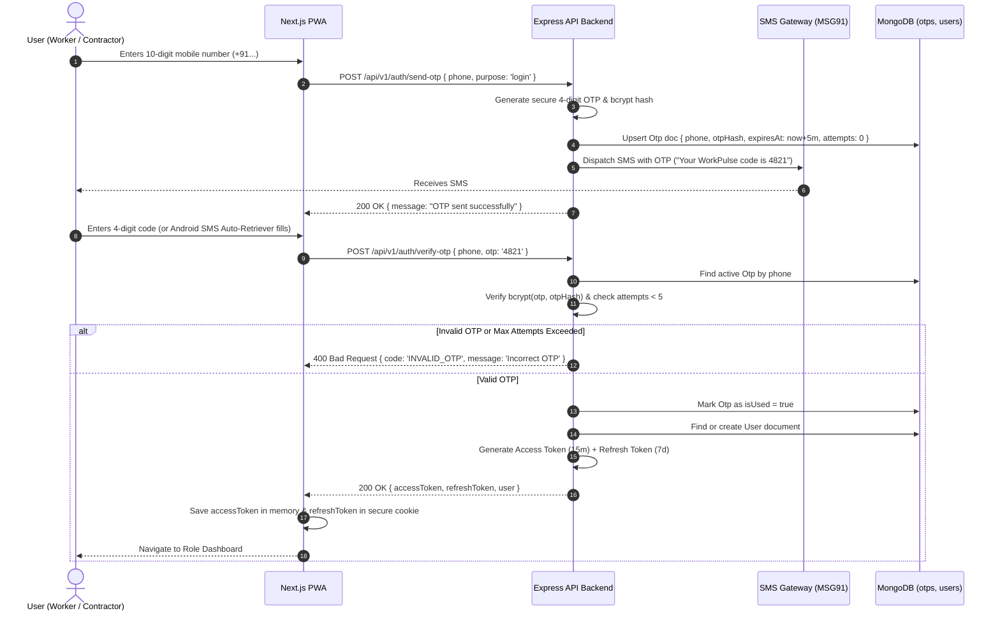

---

### 2.2 Sequence B: Job Posting -> Geo-Matching -> Broadcast -> Worker Acceptance

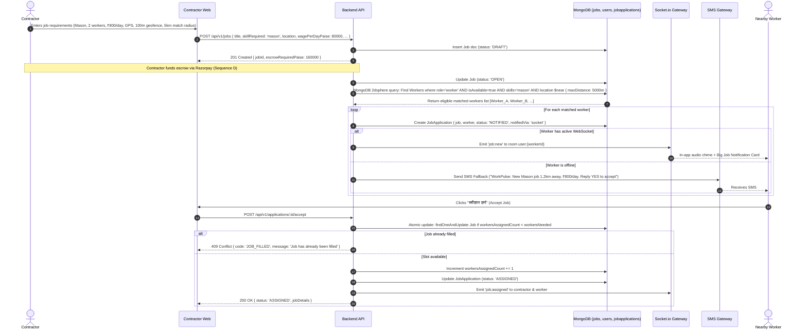

---

### 2.3 Sequence C: Geo-Fenced Check-In and Check-Out

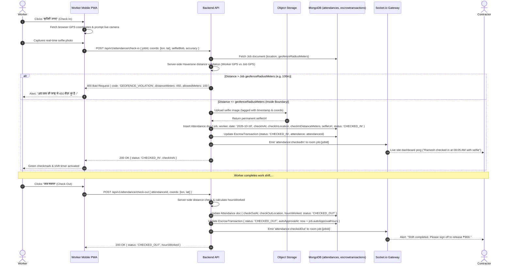

---

### 2.4 Sequence D: Escrow Fund -> Approve -> Release

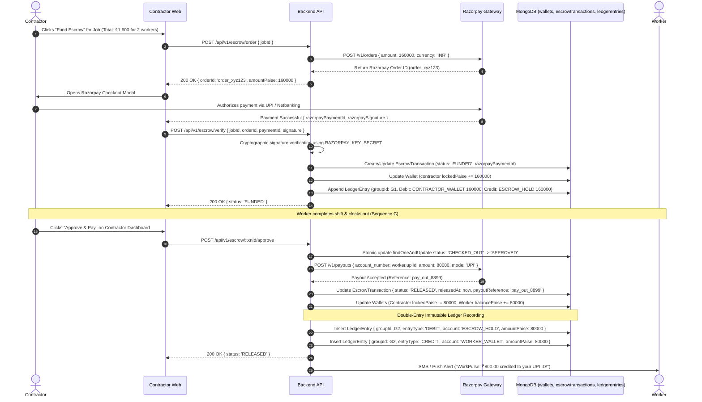

---

### 2.4 Sequence D: Phase 5 Payment Flows & Financial Operations

#### 2.4.1 Contractor Wallet Top-Up (Razorpay / Mock + Webhook Idempotency)

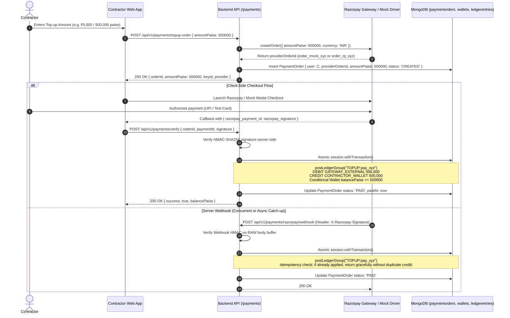

#### 2.4.2 Job Escrow Funding (Locking funds per worker per day)

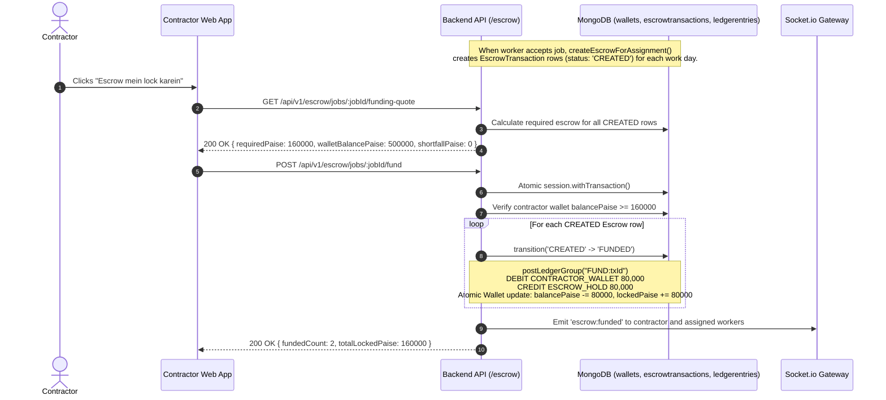

#### 2.4.3 Check-Out -> Signoff / Auto-Approval -> Release & Simulated UPI Payout

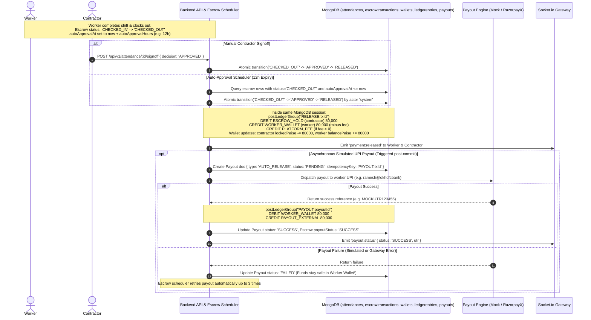

---

### 2.5 Sequence E: Dispute Arbitration & Split Settlement

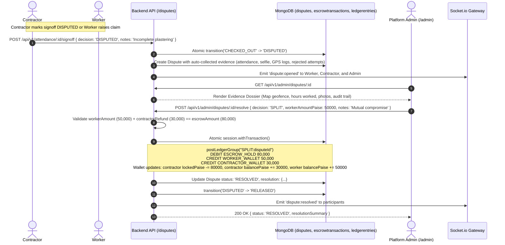

---

### 2.6 Sequence F: Voice Onboarding (Audio -> Voice-Service -> Skills -> Profile)

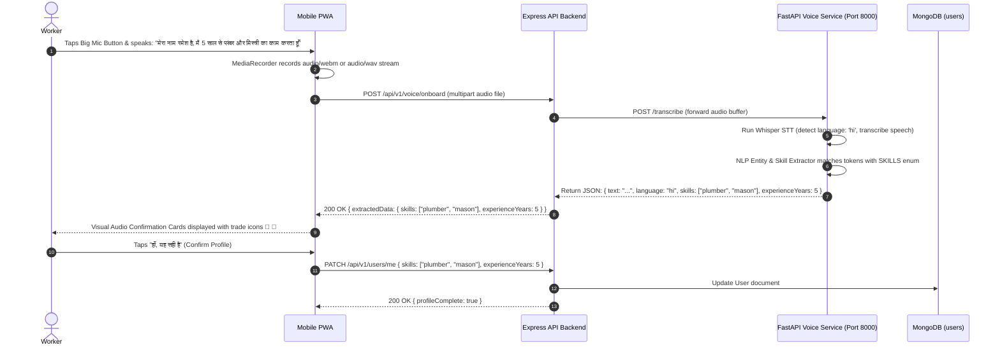

---

### 2.7 Sequence G: SOS Emergency Alert

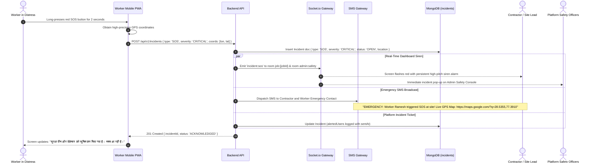

---

## 3. Technology Decisions

| Area | Choice | Rationale | Alternatives Considered |
|---|---|---|---|
| **Frontend Framework** | **Next.js 14 (App Router)** | Mobile-first PWA readiness, fast server-rendered initial viewports on 2G/3G, unified API routing. | React + Vite (SPA lacks built-in SEO and requires separate SSR server), Flutter Web (heavy canvas bundle, poor performance on low-end Android). |
| **Backend Stack** | **Node.js (Express + Socket.io)** | High concurrency for real-time WebSocket attendance/job broadcasts, lightweight I/O, massive ecosystem for Indian fintech SDKs. | Django/Python (heavier memory footprint for WebSockets), Go/Gin (slower prototyping and fewer pre-built Razorpay community wrappers). |
| **Database** | **MongoDB (Mongoose ODM)** | Native GeoJSON `2dsphere` queries for geospatial radius matching (`$near`, `$geoWithin`), flexible document model for audit trails and attendance photos. | PostgreSQL + PostGIS (excellent geo capabilities, but JSON document flexibility and rapid schema evolution favored MongoDB for Phase 1-3). |
| **Voice Processing** | **Python (FastAPI + Whisper)** | Python is the definitive ecosystem for speech-to-text (OpenAI Whisper) and Indic language NLP; separated as an isolated microservice to prevent blocking Express event loops. | Native browser Web Speech API (inconsistent support across budget Android Chrome browsers and poor regional Hindi/Marathi dialect accuracy). |
| **State Management** | **Zustand** | Minimal boilerplate (under 3KB bundle), direct localStorage persistence, zero provider hell. | Redux Toolkit (overly complex for simple role switching and auth), Context API (re-renders entire component tree on mobile). |
| **Styling & Design** | **Tailwind CSS** | Guaranteed low CSS bundle size, atomic utility classes, strict enforcement of minimum 48px touch targets for blue-collar mobile accessibility. | Styled-components (runtime CSS-in-JS overhead on budget CPUs), Material UI (heavy bundle size and complex customization). |

---

## 4. Security Architecture

1. **JWT & Refresh Strategy**:
   - Access Token: Short-lived (15 minutes), passed via `Authorization: Bearer <token>` header. Contains `{ id, role, phone }`.
   - Refresh Token: Long-lived (7 days), stored in an `HttpOnly`, `SameSite=Strict`, `Secure` cookie. Used exclusively at `/api/v1/auth/refresh-token`.
2. **Server-Side GPS Validation (Zero Client Trust)**:
   - The server never trusts client-reported distances.
   - The worker sends raw GPS coordinates `[longitude, latitude]` and accuracy radius.
   - The backend recalculates Haversine distance on the server against the canonical job coordinates in MongoDB.
   - Any check-in with GPS accuracy > 30 meters or distance > `geofenceRadiusMeters` is rejected.
3. **Rate Limiting & Anti-Bruteforce**:
   - Global rate limit: 100 requests per 15-minute window per IP.
   - OTP endpoints: Strict 3 attempts per 10 minutes per phone number to prevent SMS bombing and brute-forcing.
4. **Input Validation (Joi Middleware)**:
   - All incoming payloads are validated and sanitized using Joi schemas before hitting controllers.
   - Strips unknown fields (`stripUnknown: true`) to prevent prototype pollution and parameter injection.
5. **Selfie Image Upload Integrity**:
   - Direct multipart uploads capped at 5MB.
   - Enforced MIME-types: `image/jpeg`, `image/png`, `image/webp`.
   - EXIF metadata inspected for capture timestamp to prevent replaying stale photos.
6. **Data Protection & DPDP Act 2023 Compliance**:
   - Explicit consent logged at registration for geolocation tracking during active job shifts only.
   - Tracking is terminated immediately upon checkout.
   - Phone numbers masked in public contractor listings until worker assignment is confirmed.
   - Immutable audit logs record all administrative access to worker PII.

---

## 5. Non-Functional & Reliability Requirements

1. **Low-Bandwidth & 2G/3G Network Resilience**:
   - Total frontend initial bundle < 120KB gzip.
   - Next.js static asset optimization with aggressive HTTP caching.
   - High contrast UI avoids decorative images, relying on lightweight Lucide vector icons.
2. **PWA Offline Behavior**:
   - Service worker caches application shell, Hindi localization strings, and offline job cards.
   - Background sync queues check-ins if connection drops momentarily at remote construction sites.
3. **Idempotency Safeguards**:
   - All financial operations (`/escrow/order`, `/escrow/release`, `/escrow/refund`) require a unique `idempotencyKey` UUID.
   - Prevents duplicate debiting if network retries occur.
4. **Immutable Audit Logging**:
   - Every financial state transition and admin intervention creates an append-only document in `auditlogs` and `ledgerentries`.
   - MongoDB pre-save hooks prevent document modification or deletion.

---

## 6. Out-of-Scope (Phase 1 Blueprint Boundaries)

* **RBI-Licensed Escrow Banking**: Production escrow will interface with Razorpay in Test Mode + an internal double-entry ledger. Real escrow trustee accounts (e.g. ICICI Trustee / Escrowpay) will be integrated in future phases.
* **Aadhaar eKYC Biometrics**: Real UIDAI Aadhaar biometrics are excluded. Simulated OTP verification and phone validation are utilized.
* **Native Mobile Apps (Android APK / iOS)**: The system is designed and deployed as a responsive, installable Progressive Web App (PWA). Native wrappers (React Native / Capacitor) remain out of current scope.

---

## 7. Voice Onboarding Architecture (Phase 6)

### 7.1 Overview & Dual-Path Strategy
WorkPulse provides a voice-first onboarding flow for blue-collar workers speaking Hindi, Marathi, or English. To ensure reliability across diverse devices, browsers, and low-connectivity environments, the system implements a dual-path architecture with a guaranteed icon-grid fallback.

1. **WebSpeech Path (Browser STT + Server Extraction)**:
   - Available on Chromium browsers with online connectivity.
   - Browser's Web Speech API produces real-time interim and final transcripts locally/via browser speech services.
   - Backend Express forwards the transcript to Python FastAPI `voice-service` (`POST /extract`).
   - Pure Python rule-based deterministic extractor parses skills, compound phrases, negations, and experience years.
2. **Server Audio Path (Audio Recording + Whisper STT + Server Extraction)**:
   - Used when Web Speech API is unsupported, offline, or chosen by the worker.
   - Browser records audio (WebM/WAV/Ogg/MP4) via `MediaRecorder` in-memory.
   - Backend Express verifies magic bytes and forwards the in-memory buffer via multipart to `voice-service` (`POST /onboard`).
   - `voice-service` transcribes via `faster-whisper` (or mock/OpenAI) and extracts skills in a single pipeline.
3. **Privacy & DPDP Act 2023 Compliance**:
   - **Zero Audio Persistence**: Raw audio bytes are NEVER stored on disk, DB, or logs. Processing occurs strictly in memory (`io.BytesIO` / Multer memory storage).
   - **Draft Isolation**: Neither `/voice/extract` nor `/voice/onboard` writes skills to the worker's `User` document. Extracted skills remain a DRAFT until the worker confirms on screen.
   - **Data Minimization & TTL**: Transcripts are capped at 500 characters and stored in `voicesessions` with a MongoDB TTL index that auto-deletes records after 90 days.
4. **Icon Grid Fallback**:
   - Always accessible from consent decline, mic denial, service offline (`503 VOICE_UNAVAILABLE`), or user choice.
   - Saves final skills via `POST /voice/confirm` with `method: ICON_FALLBACK`.

### 7.2 Voice Onboarding Sequence Diagram

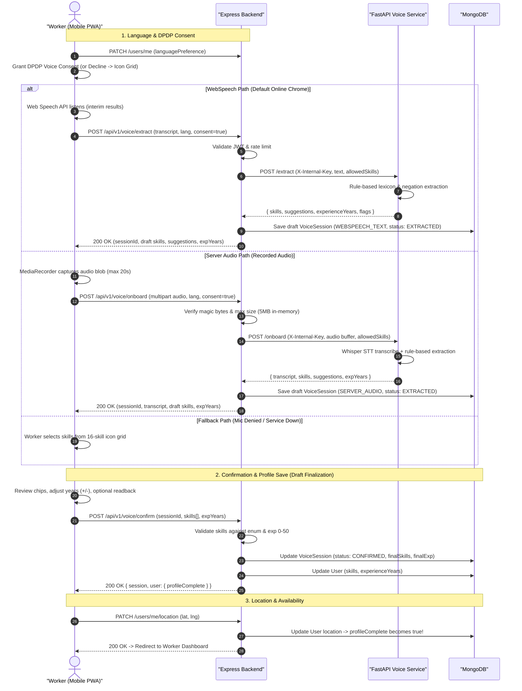

---

## 8. Phase 7: Reputation & Safety Architecture

WorkPulse implements double-blind ratings to eliminate retaliatory rating bias and provides a zero-failure emergency SOS mechanism.

### 8.1 Two-Way Rating with Double-Blind Reveal Sequence

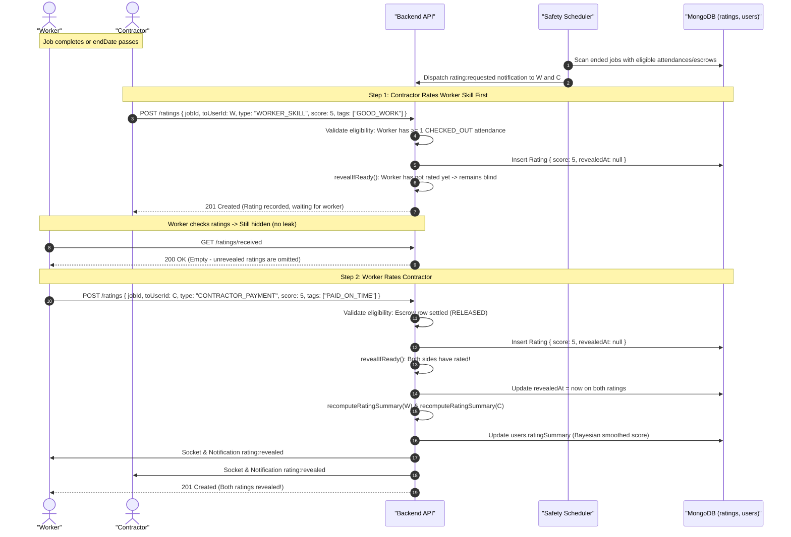

### 8.2 Emergency SOS Trigger, Alerting, Escalation & Resolution

```mermaid
sequenceDiagram
    autonumber
    actor W as "Worker (In Distress)"
    actor Co as "Coworkers on Job"
    actor C as "Contractor"
    actor Em as "Emergency Contact"
    participant B as "Backend API"
    participant S as "Safety Scheduler"
    participant Adm as "Admins"
    participant DB as "MongoDB (incidents)"

    Note over W: Worker holds SOS button for 2 seconds
    Note over W: 5-second cancel countdown passes
    W->>W: Fetch GPS fix (4s timeout; fallback to last known if unavailable)
    W->>B: POST /incidents/sos { idempotencyKey, lat, lng, accuracy, notifyContractor: true }

    B->>DB: Upsert Incident (idempotent, type: "SOS", severity: "CRITICAL", status: "OPEN")
    B->>DB: Append timeline "CREATED" and "ALERTED"

    par Multi-Channel Immediate Dispatch
        B->>C: Socket sos:alert + SMS with Google Maps link
    and
        B->>Co: Socket sos:alert (same job coworkers)
    and
        B->>Em: SMS to Emergency Contact ("WorkPulse SOS: Madad chahiye...")
    and
        B->>Adm: Socket sos:alert to role:admin room
    end

    B-->>W: 201 Created { incidentId, alerted: { contractor: true, coworkers: 1, emergencyContact: true, admins: true } }

    loop Every 15 Seconds
        W->>B: POST /incidents/:id/location { lat, lng, accuracy }
        B->>DB: Append locationTrail (capped at 50)
        B->>C: Socket sos:location (live map update)
        B->>Adm: Socket sos:location
    end

    opt Unacknowledged Escalation
        Note over S: If status remains OPEN after 60s
        S->>DB: Transition escalationLevel: 0 -> 1, timeline "ESCALATED_1"
        S->>C: Re-send SMS with latest location link
        S->>Em: Re-send SMS
        S->>Adm: Socket sos:escalated { level: 1 }
    end

    Note over C,B: Contractor Acknowledges
    C->>B: POST /incidents/:id/acknowledge
    B->>DB: Atomic update status: "ACKNOWLEDGED", alertedUsers.ackAt = now
    B->>W: Socket sos:acknowledged ("Contractor ne dekh liya, madad aa rahi hai")

    Note over W,B: Worker Reaches Safety
    W->>B: POST /incidents/:id/resolve { resolutionType: "SELF_SAFE" }
    B->>DB: Update status: "RESOLVED", resolvedBy: W, resolvedAt: now
    B->>C: Socket sos:resolved
    B->>Adm: Socket sos:resolved
    B-->>W: 200 OK (Resolved)
```
