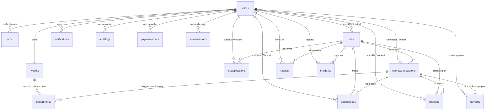

# WorkPulse – Database Schema Specification (Phase 6)

---

## 0. Money Rules & Accounting Convention
- **Integer Paise Only:** Money is ALWAYS stored as integer paise in DB, API, and internal code (`Number.isSafeInteger`). Floating point math for currency is strictly prohibited.
- **Ledger Convention:**
  - `DEBIT`: Money leaves that account.
  - `CREDIT`: Money enters that account.
- **Double-Entry Invariant:** Every ledger group strictly satisfies $\sum \text{DEBIT} == \sum \text{CREDIT}$.
- **Wallet Balances:**
  - `balancePaise`: Usable available funds (modified by `CONTRACTOR_WALLET` and `WORKER_WALLET` entries).
  - `lockedPaise`: Funds locked in platform escrow hold (modified by `ESCROW_HOLD` entries for that wallet).
- **Running Balance:** `balanceAfterPaise` on each ledger entry reflects the affected wallet field (`balancePaise` or `lockedPaise`) immediately post-entry.
- **Immutability:** `ledgerentries` is strictly append-only. Mongoose middleware rejects any `updateOne`, `updateMany`, `findOneAndUpdate`, `deleteOne`, `deleteMany`, `replaceOne`, or `save` on existing records. Financial adjustments are executed solely via reversing entries.

---

## 1. Entity-Relationship Overview (16 Collections)

The database consists of 16 MongoDB collections created via Mongoose (lowercase plural).



---

## 2. Collections Summary Table

| Collection Name | Primary Purpose | Approx Growth Rate | Retention Policy |
|---|---|---|---|
| `users` | User accounts, profiles, skills, UPI ID, and geo-locations | Low (1 doc / registered user) | Permanent |
| `otps` | Short-lived OTP codes for phone verification | Medium (transient) | TTL: 5 minutes auto-delete |
| `wallets` | Integer paise balance container (`balancePaise`, `lockedPaise`, `version`) | Low (1 doc / user) | Permanent |
| `jobs` | Job requisition postings and geofence parameters | Medium | Permanent |
| `jobapplications` | Worker match notification and application states | High (N docs / job) | 180 Days |
| `attendances` | GPS and selfie proof-of-work records | High (1 doc / worker / day) | Permanent |
| `escrowtransactions` | Daily financial state machine records per worker per day | High (1 doc / worker / day) | 7 Years (Financial Compliance) |
| `ledgerentries` | Immutable double-entry financial audit logs (APPEND-ONLY) | Very High (2+ docs / txn) | Permanent (Append-Only) |
| `paymentorders` | External contractor wallet top-up records (Razorpay/Mock) | Medium | 7 Years (Compliance) |
| `payouts` | Worker UPI payout dispatches (Auto-release / Withdrawal) | High (1 doc / payout) | 7 Years (Compliance) |
| `ratings` | Two-way reputation reviews | Medium (2 docs / job completion) | Permanent |
| `incidents` | Emergency SOS and site safety conflict logs | Low | Permanent |
| `disputes` | Formal arbitration files with uploaded evidence | Low | Permanent |
| `notifications` | Socket, Push, and SMS notification records | Very High | TTL: 90 Days auto-delete |
| `auditlogs` | Immutable system event and financial access logs | Very High | 7 Years (Compliance) |
| `voicesessions` | Voice onboarding transcripts, draft skills, method, and impact metrics | Medium (1 doc / voice attempt) | TTL: 90 Days auto-delete |

---

## 3. Detailed Collection Schemas

---

### 3.1 `users`
**Purpose**: Stores all authenticated actors (workers, contractors, admins), their profile details, E.164 phone numbers, fixed trade skills, location coordinates, and rating aggregates.

| Field Name | Type | Required | Default | Notes |
|---|---|---|---|---|
| `_id` | ObjectId | Yes | auto | Primary Key |
| `name` | String | Yes | - | Full Name |
| `phone` | String | Yes | - | Unique E.164 format (e.g. `+919876543210`) |
| `role` | String | Yes | `worker` | Enum: `worker`, `contractor`, `admin` |
| `languagePreference` | String | Yes | `hi` | Enum: `hi`, `mr`, `en` |
| `skills` | [String] | No | `[]` | Array of strings from standard `SKILLS` enum |
| `experienceYears` | Number | No | `0` | Trade experience in years (min: 0) |
| `location` | GeoJSON Point | Yes | `[0, 0]` | Coordinates: `[longitude, latitude]` |
| `address` | String | No | `""` | Human-readable address |
| `profilePhotoUrl` | String | No | `""` | CDN photo link |
| `upiId` | String | No | `""` | VPA address for payouts (e.g. `user@okhdfcbank`) |
| `isVerified` | Boolean | Yes | `false` | Phone verified flag |
| `kycStatus` | String | Yes | `none` | Enum: `none`, `simulated_verified` |
| `isActive` | Boolean | Yes | `true` | Account standing |
| `isAvailable` | Boolean | Yes | `true` | Worker availability for new job alerts |
| `ratingSummary` | Object | Yes | `{...}` | Embedded aggregates: `workerSkillAvg`, `workerSkillCount`, `contractorPaymentAvg`, `contractorSafetyAvg`, `contractorCount` |
| `emergencyContact` | Object | No | `{...}` | Embedded: `{ name, phone }` |
| `fcmOrPushToken` | String | No | `""` | Mobile device notification token |
| `lastLoginAt` | Date | No | `null` | Timestamp of last authentication |
| `createdAt` | Date | Yes | auto | Creation timestamp |
| `updatedAt` | Date | Yes | auto | Last update timestamp |

* **Indexes**:
  * `{ phone: 1 }` (Unique)
  * `{ location: "2dsphere" }`
  * `{ role: 1, skills: 1, isAvailable: 1 }` (Compound matching index)
* **Relationships**:
  * Has one `wallets` document (`wallets.user`).
  * Has many `jobs`, `attendances`, `ratings`.
* **Example JSON**:
```json
{
  "_id": "671230000000000000000001",
  "name": "Ramesh Kumar",
  "phone": "+919876543210",
  "role": "worker",
  "languagePreference": "hi",
  "skills": ["mason", "plumber"],
  "experienceYears": 4,
  "location": { "type": "Point", "coordinates": [77.3910, 28.5355] },
  "address": "Sector 62, Noida, UP",
  "profilePhotoUrl": "https://cdn.workpulse.in/profiles/ramesh.jpg",
  "upiId": "ramesh@paytm",
  "isVerified": true,
  "kycStatus": "simulated_verified",
  "isActive": true,
  "isAvailable": true,
  "ratingSummary": {
    "workerSkillAvg": 4.8,
    "workerSkillCount": 24,
    "contractorPaymentAvg": 0,
    "contractorSafetyAvg": 0,
    "contractorCount": 0
  },
  "emergencyContact": { "name": "Suresh Kumar", "phone": "+919876543211" },
  "createdAt": "2026-10-18T06:00:00.000Z",
  "updatedAt": "2026-10-18T06:00:00.000Z"
}
```

---

### 3.2 `otps`
**Purpose**: Ephemeral one-time passwords for passwordless mobile sign-in. Documents are purged automatically via MongoDB TTL.

| Field Name | Type | Required | Default | Notes |
|---|---|---|---|---|
| `_id` | ObjectId | Yes | auto | Primary Key |
| `phone` | String | Yes | - | E.164 phone string |
| `otpHash` | String | Yes | - | Bcrypt hashed 4-digit code (never plain text) |
| `purpose` | String | Yes | `login` | Enum: `login`, `register` |
| `attempts` | Number | Yes | `0` | Failed attempts counter (max: 5) |
| `expiresAt` | Date | Yes | - | Expiration timestamp (now + 5 minutes) |
| `isUsed` | Boolean | Yes | `false` | Becomes true upon successful verification |
| `createdAt` | Date | Yes | auto | Document creation timestamp |
| `updatedAt` | Date | Yes | auto | Document update timestamp |

* **Indexes**:
  * `{ expiresAt: 1 }` (TTL: `expireAfterSeconds: 0`)
  * `{ phone: 1, purpose: 1, isUsed: 1 }`
* **Example JSON**:
```json
{
  "_id": "671230000000000000000002",
  "phone": "+919876543210",
  "otpHash": "$2a$10$e8Z4zJb1l7QvX8dE9sF1ye2j8s5l9m4n2k1l8j7h6g5f4d3s2a1",
  "purpose": "login",
  "attempts": 0,
  "expiresAt": "2026-10-18T06:05:00.000Z",
  "isUsed": false,
  "createdAt": "2026-10-18T06:00:00.000Z",
  "updatedAt": "2026-10-18T06:00:00.000Z"
}
```

---

### 3.3 `wallets`
**Purpose**: Represents financial containers for contractors and workers. Stores amounts strictly as integer Paise.

| Field Name | Type | Required | Default | Notes |
|---|---|---|---|---|
| `_id` | ObjectId | Yes | auto | Primary Key |
| `user` | ObjectId | Yes | - | Ref: `User` (Unique) |
| `balancePaise` | Number | Yes | `0` | Available balance in integer paise (₹1 = 100 paise) |
| `lockedPaise` | Number | Yes | `0` | Funds currently reserved in active escrow |
| `currency` | String | Yes | `INR` | ISO Currency Code |
| `status` | String | Yes | `active` | Enum: `active`, `frozen` |
| `createdAt` | Date | Yes | auto | Creation timestamp |
| `updatedAt` | Date | Yes | auto | Update timestamp |

* **Indexes**:
  * `{ user: 1 }` (Unique)
* **Example JSON**:
```json
{
  "_id": "671230000000000000000003",
  "user": "671230000000000000000001",
  "balancePaise": 240000,
  "lockedPaise": 80000,
  "currency": "INR",
  "status": "active",
  "createdAt": "2026-10-18T06:00:00.000Z",
  "updatedAt": "2026-10-18T06:00:00.000Z"
}
```

---

### 3.4 `jobs`
**Purpose**: Job requisitions posted by contractors, defining required skills, site GPS coordinates, geofence radius, and daily wages.

| Field Name | Type | Required | Default | Notes |
|---|---|---|---|---|
| `_id` | ObjectId | Yes | auto | Primary Key |
| `contractor` | ObjectId | Yes | - | Ref: `User` |
| `title` | String | Yes | - | Short descriptive job title |
| `description` | String | No | `""` | Detailed instructions |
| `skillRequired` | String | Yes | - | Enum from `SKILLS` |
| `workersNeeded` | Number | Yes | `1` | Total workers required (min: 1) |
| `workersAssignedCount` | Number | Yes | `0` | Currently assigned worker count |
| `wagePerDayPaise` | Number | Yes | - | Daily wage per worker in integer Paise |
| `startDate` | Date | Yes | - | Shift start date |
| `endDate` | Date | Yes | - | Shift end date |
| `totalDays` | Number | Yes | `1` | Total scheduled working days |
| `workingHours` | Object | Yes | `{ start: "09:00", end: "17:00" }` | Shift daily hours |
| `location` | GeoJSON Point | Yes | - | Site center coordinates `[lon, lat]` |
| `addressText` | String | No | `""` | Human-readable job location |
| `geofenceRadiusMeters`| Number | Yes | `100` | Allowed check-in radius (default: 100m) |
| `matchRadiusKm` | Number | Yes | `5` | Broadcast radius to search workers (default: 5km) |
| `status` | String | Yes | `DRAFT` | Enum: `DRAFT`, `OPEN`, `FILLED`, `IN_PROGRESS`, `COMPLETED`, `CANCELLED`, `EXPIRED` |
| `requiresSelfie` | Boolean | Yes | `true` | Enforces selfie capture at check-in |
| `autoApprovalHours` | Number | Yes | `12` | Hours after checkout before auto-approval (default: 12h) |
| `attendanceCodeSecret` | String | No | auto | Secret key used for daily 6-digit HMAC attendance code generation (`select: false`) |
| `createdVia` | String | Yes | `app` | Enum: `app`, `voice`, `sms` |
| `createdAt` | Date | Yes | auto | Creation timestamp |
| `updatedAt` | Date | Yes | auto | Update timestamp |

* **Indexes**:
  * `{ location: "2dsphere" }`
  * `{ status: 1, skillRequired: 1, startDate: 1 }`
  * `{ contractor: 1, status: 1 }`
* **Example JSON**:
```json
{
  "_id": "671230000000000000000004",
  "contractor": "671230000000000000000099",
  "title": "Mason needed for brick laying",
  "description": "Boundary wall construction, mortar provided",
  "skillRequired": "mason",
  "workersNeeded": 2,
  "workersAssignedCount": 1,
  "wagePerDayPaise": 85000,
  "startDate": "2026-10-19T03:30:00.000Z",
  "endDate": "2026-10-21T12:30:00.000Z",
  "totalDays": 3,
  "workingHours": { "start": "09:00", "end": "18:00" },
  "location": { "type": "Point", "coordinates": [77.3850, 28.5300] },
  "addressText": "Plot 45, Sector 63, Noida",
  "geofenceRadiusMeters": 100,
  "matchRadiusKm": 5,
  "status": "OPEN",
  "requiresSelfie": true,
  "autoApprovalHours": 12,
  "createdVia": "app",
  "createdAt": "2026-10-18T06:00:00.000Z",
  "updatedAt": "2026-10-18T06:00:00.000Z"
}
```

---

### 3.5 `jobapplications`
**Purpose**: Tracks job broadcast notifications to nearby workers and their responses.

| Field Name | Type | Required | Default | Notes |
|---|---|---|---|---|
| `_id` | ObjectId | Yes | auto | Primary Key |
| `job` | ObjectId | Yes | - | Ref: `Job` |
| `worker` | ObjectId | Yes | - | Ref: `User` |
| `status` | String | Yes | `NOTIFIED` | Enum: `NOTIFIED`, `ACCEPTED`, `REJECTED`, `EXPIRED`, `WITHDRAWN`, `ASSIGNED` |
| `notifiedAt` | Date | Yes | `now` | Broadcast timestamp |
| `respondedAt` | Date | No | `null` | When worker tapped accept/reject |
| `notifiedVia` | String | Yes | `socket` | Enum: `socket`, `sms`, `push` |
| `createdAt` | Date | Yes | auto | Creation timestamp |
| `updatedAt` | Date | Yes | auto | Update timestamp |

* **Indexes**:
  * `{ job: 1, worker: 1 }` (Unique)
  * `{ worker: 1, status: 1 }`
* **Example JSON**:
```json
{
  "_id": "671230000000000000000005",
  "job": "671230000000000000000004",
  "worker": "671230000000000000000001",
  "status": "ASSIGNED",
  "notifiedAt": "2026-10-18T06:01:00.000Z",
  "respondedAt": "2026-10-18T06:03:15.000Z",
  "notifiedVia": "socket",
  "createdAt": "2026-10-18T06:01:00.000Z",
  "updatedAt": "2026-10-18T06:03:15.000Z"
}
```

---

### 3.6 `attendances`
**Purpose**: Immutable daily proof-of-work records capturing geofenced GPS coordinates, distance, and verified selfies.

| Field Name | Type | Required | Default | Notes |
|---|---|---|---|---|
| `_id` | ObjectId | Yes | auto | Primary Key |
| `job` | ObjectId | Yes | - | Ref: `Job` |
| `worker` | ObjectId | Yes | - | Ref: `User` |
| `date` | String | Yes | - | Date string `YYYY-MM-DD` |
| `checkInAt` | Date | No | `null` | Check-in timestamp |
| `checkOutAt` | Date | No | `null` | Check-out timestamp |
| `checkInLocation` | GeoJSON Point | No | - | GPS coords at check-in |
| `checkOutLocation` | GeoJSON Point | No | - | GPS coords at check-out |
| `checkInDistanceMeters` | Number | No | `null` | Distance from site center (meters) |
| `checkOutDistanceMeters`| Number | No | `null` | Distance from site center at checkout |
| `checkInAccuracyM` | Number | No | `null` | GPS horizontal accuracy (meters) at check-in |
| `checkOutAccuracyM`| Number | No | `null` | GPS horizontal accuracy (meters) at checkout |
| `clientTimestamp` | Date | No | `null` | Reported client device time (clock-drift verified) |
| `selfieUrl` | String | No | `""` | Relative path to verified selfie photo under uploads |
| `selfieCheckoutUrl` | String | No | `""` | Optional relative path to checkout selfie photo |
| `qrToken` | String | No | `""` | Optional site supervisor QR token |
| `qrUsed` | Boolean | Yes | `false` | True when 6-digit daily code fallback was verified |
| `method` | String | Yes | `gps_selfie` | Enum: `gps_selfie`, `gps_qr` |
| `autoCheckout` | Boolean | Yes | `false` | True if automatically checked out by scheduler |
| `flags` | [String] | Yes | `[]` | Warning flags: `LOW_ACCURACY_WARN`, `AUTO_CHECKOUT`, `OUTSIDE_FENCE_AT_CHECKOUT` |
| `hoursWorked` | Number | Yes | `0` | Calculated work duration in hours (decimal, 2 places) |
| `status` | String | Yes | `CHECKED_IN` | Enum: `CHECKED_IN`, `CHECKED_OUT`, `MISSED`, `REJECTED` |
| `rejectionReason` | String | No | `""` | Explanation if check-in rejected or marked `MISSED` |
| `contractorSignoff` | Object | Yes | `{...}` | Embedded: `{ status: "PENDING", at: null, by: null, reason: "" }` |
| `deviceInfo` | Object | No | `{...}` | Embedded: `{ platform, batteryLevel, accuracy, userAgent, screen }` |
| `createdAt` | Date | Yes | auto | Creation timestamp |
| `updatedAt` | Date | Yes | auto | Update timestamp |

* **Design Rule**: Attendance proof data is strictly immutable once status is `CHECKED_OUT`, `MISSED`, or `REJECTED`. Only `contractorSignoff` can be modified. Mongoose pre-save and pre-update guards enforce this.
* **Indexes**:
  * `{ job: 1, worker: 1, date: 1 }` (Unique)
  * `{ worker: 1, date: 1 }`
* **Example JSON**:
```json
{
  "_id": "671230000000000000000006",
  "job": "671230000000000000000004",
  "worker": "671230000000000000000001",
  "date": "2026-10-19",
  "checkInAt": "2026-10-19T03:32:00.000Z",
  "checkOutAt": "2026-10-19T12:35:00.000Z",
  "checkInLocation": { "type": "Point", "coordinates": [77.3852, 28.5301] },
  "checkOutLocation": { "type": "Point", "coordinates": [77.3851, 28.5302] },
  "checkInDistanceMeters": 24,
  "checkOutDistanceMeters": 28,
  "selfieUrl": "https://cdn.workpulse.in/attendance/selfies/att_6712_in.jpg",
  "method": "gps_selfie",
  "hoursWorked": 9.05,
  "status": "CHECKED_OUT",
  "contractorSignoff": {
    "status": "APPROVED",
    "at": "2026-10-19T13:00:00.000Z",
    "by": "671230000000000000000099"
  },
  "deviceInfo": { "platform": "Android 13", "accuracy": 12 },
  "createdAt": "2026-10-19T03:32:00.000Z",
  "updatedAt": "2026-10-19T13:00:00.000Z"
}
```

---

### 3.7 `escrowtransactions`
**Purpose**: Manages the escrow lifecycle per worker per working day. Amount stored strictly in integer Paise.

| Field Name | Type | Required | Default | Notes |
|---|---|---|---|---|
| `_id` | ObjectId | Yes | auto | Primary Key |
| `job` | ObjectId | Yes | - | Ref: `Job` |
| `attendance` | ObjectId | No | `null` | Ref: `Attendance` (linked upon check-in) |
| `contractor` | ObjectId | Yes | - | Ref: `User` |
| `worker` | ObjectId | Yes | - | Ref: `User` |
| `amountPaise` | Number | Yes | - | Daily wage in integer Paise (e.g. 85000 = ₹850) |
| `platformFeePaise`| Number | Yes | `0` | Platform fee in integer Paise |
| `status` | String | Yes | `CREATED` | Enum: `CREATED`, `FUNDED`, `CHECKED_IN`, `CHECKED_OUT`, `APPROVED`, `RELEASED`, `DISPUTED`, `CANCELLED`, `REFUNDED` |
| `statusHistory` | [Object] | Yes | `[]` | Embedded audit trail: `[{ from, to, at, by, reason }]` |
| `razorpayOrderId` | String | No | `""` | Razorpay order identifier |
| `razorpayPaymentId`| String | No | `""` | Razorpay capture ID |
| `payoutReference` | String | No | `""` | UPI payout reference ID |
| `idempotencyKey` | String | Yes | - | Unique UUID preventing duplicate payments |
| `autoApprovalAt` | Date | No | `null` | Target timestamp for auto-approval worker trigger |
| `releasedAt` | Date | No | `null` | When payout was successfully released |
| `dayDate` | String | Yes | - | Date string `YYYY-MM-DD` |
| `createdAt` | Date | Yes | auto | Creation timestamp |
| `updatedAt` | Date | Yes | auto | Update timestamp |

* **Indexes**:
  * `{ idempotencyKey: 1 }` (Unique)
  * `{ job: 1, worker: 1, dayDate: 1 }` (Unique)
  * `{ status: 1, autoApprovalAt: 1 }` (For auto-approval background worker)
* **Example JSON**:
```json
{
  "_id": "671230000000000000000007",
  "job": "671230000000000000000004",
  "attendance": "671230000000000000000006",
  "contractor": "671230000000000000000099",
  "worker": "671230000000000000000001",
  "amountPaise": 85000,
  "platformFeePaise": 0,
  "status": "RELEASED",
  "statusHistory": [
    { "from": "CREATED", "to": "FUNDED", "at": "2026-10-18T06:05:00.000Z", "by": "671230000000000000000099" },
    { "from": "FUNDED", "to": "CHECKED_IN", "at": "2026-10-19T03:32:00.000Z", "by": "671230000000000000000001" },
    { "from": "CHECKED_IN", "to": "CHECKED_OUT", "at": "2026-10-19T12:35:00.000Z", "by": "671230000000000000000001" },
    { "from": "CHECKED_OUT", "to": "APPROVED", "at": "2026-10-19T13:00:00.000Z", "by": "671230000000000000000099" },
    { "from": "APPROVED", "to": "RELEASED", "at": "2026-10-19T13:00:05.000Z" }
  ],
  "razorpayOrderId": "order_NXy8349283",
  "razorpayPaymentId": "pay_NXy8934298",
  "payoutReference": "pout_NXz120938",
  "idempotencyKey": "a82b9932-5178-4ea8-9bf9-9c1234abcd56",
  "autoApprovalAt": "2026-10-20T00:35:00.000Z",
  "releasedAt": "2026-10-19T13:00:05.000Z",
  "dayDate": "2026-10-19",
  "createdAt": "2026-10-18T06:00:00.000Z",
  "updatedAt": "2026-10-19T13:00:05.000Z"
}
```

---

### 3.8 `ledgerentries` (APPEND-ONLY)
**Purpose**: Immutable double-entry bookkeeping ledger. Every money movement generates paired debit and credit records linked by `groupId`. Updates and deletes are prohibited.

| Field Name | Type | Required | Default | Notes |
|---|---|---|---|---|
| `_id` | ObjectId | Yes | auto | Primary Key |
| `transaction` | ObjectId | Yes | - | Ref: `EscrowTransaction` |
| `wallet` | ObjectId | Yes | - | Ref: `Wallet` |
| `entryType` | String | Yes | - | Enum: `DEBIT`, `CREDIT` |
| `account` | String | Yes | - | Enum: `CONTRACTOR_WALLET`, `ESCROW_HOLD`, `WORKER_WALLET`, `PLATFORM_FEE`, `REFUND` |
| `amountPaise` | Number | Yes | - | Amount in integer Paise |
| `balanceAfterPaise` | Number | Yes | - | Account balance post-entry |
| `referenceType` | String | Yes | `ESCROW_SETTLEMENT` | Category of movement |
| `referenceId` | String | No | `""` | External gateway transaction reference |
| `description` | String | Yes | - | Human-readable audit description |
| `groupId` | String | Yes | - | UUID grouping both sides of one double-entry transaction |
| `createdAt` | Date | Yes | `now` | Immutable timestamp (never updated) |

* **Indexes**:
  * `{ transaction: 1 }`
  * `{ wallet: 1 }`
  * `{ groupId: 1 }`
* **Example JSON (Paired Entry)**:
```json
[
  {
    "_id": "671230000000000000000008",
    "transaction": "671230000000000000000007",
    "wallet": "671230000000000000000003",
    "entryType": "DEBIT",
    "account": "ESCROW_HOLD",
    "amountPaise": 85000,
    "balanceAfterPaise": 0,
    "referenceType": "ESCROW_RELEASE",
    "description": "Escrow released to worker for job 671230000000000000000004",
    "groupId": "d4e5f6a7-1234-5678-90ab-cdef12345678",
    "createdAt": "2026-10-19T13:00:05.000Z"
  },
  {
    "_id": "671230000000000000000009",
    "transaction": "671230000000000000000007",
    "wallet": "671230000000000000000099",
    "entryType": "CREDIT",
    "account": "WORKER_WALLET",
    "amountPaise": 85000,
    "balanceAfterPaise": 85000,
    "referenceType": "ESCROW_RELEASE",
    "description": "Daily wage payout credited to worker wallet",
    "groupId": "d4e5f6a7-1234-5678-90ab-cdef12345678",
    "createdAt": "2026-10-19T13:00:05.000Z"
  }
]
```

---

### 3.9 `ratings`
**Purpose**: Double-blind, two-way reputation reviews between workers and contractors with Bayesian smoothing.

| Field Name | Type | Required | Default | Notes |
|---|---|---|---|---|
| `_id` | ObjectId | Yes | auto | Primary Key |
| `job` | ObjectId | Yes | - | Ref: `Job` (Immutable) |
| `fromUser` | ObjectId | Yes | - | Ref: `User` (Reviewer, Immutable) |
| `toUser` | ObjectId | Yes | - | Ref: `User` (Recipient, Immutable) |
| `type` | String | Yes | - | Enum: `WORKER_SKILL`, `CONTRACTOR_PAYMENT`, `CONTRACTOR_SAFETY` (Immutable) |
| `score` | Number | Yes | - | Integer 1 to 5 (Immutable) |
| `tags` | [String] | No | `[]` | Enum catalog tags (max 4) |
| `comment` | String | No | `""` | Feedback text (max: 300 chars, stripped of HTML) |
| `revealedAt` | Date | No | `null` | Null during blind window; set when both sides rate or window closes |
| `isHidden` | Boolean | Yes | `false` | Moderation hide flag |
| `hiddenBy` | ObjectId | No | `null` | Ref: `User` (Admin who hid rating) |
| `hiddenReason` | String | No | `""` | Mandatory reason for hiding (min 5 chars) |
| `hiddenAt` | Date | No | `null` | Timestamp when hidden |
| `reportedByRecipient`| Boolean | Yes | `false` | Flag if rated recipient reported unfair |
| `reportReason` | String | No | `""` | Recipient unfairness reason |
| `createdAt` | Date | Yes | auto | Creation timestamp |
| `updatedAt` | Date | Yes | auto | Update timestamp |

* **Indexes**:
  * `{ job: 1, fromUser: 1, toUser: 1, type: 1 }` (Unique: Prevents duplicate rating per category)
  * `{ toUser: 1, revealedAt: 1, isHidden: 1 }` (High efficiency reputation aggregate index)
* **Immutability Guard**: `score`, `type`, `job`, `fromUser`, `toUser` are immutable after creation.
* **Double-Blind Mechanism**: Created with `revealedAt = null`. Revealed when contractor rates worker skill AND worker rates contractor payment/safety, or when the 14-day window closes.
* **Bayesian Smoothing**: Aggregate score = `(PRIOR_COUNT * PRIOR_MEAN + sum) / (PRIOR_COUNT + count)` where $C=3, M=4.0$.

---

### 3.10 `incidents`
**Purpose**: Immutable incident and emergency SOS audit logs, location trails, real-time alerts, and escalation timelines.

| Field Name | Type | Required | Default | Notes |
|---|---|---|---|---|
| `_id` | ObjectId | Yes | auto | Primary Key |
| `job` | ObjectId | No | `null` | Ref: `Job` (Optional context) |
| `reportedBy` | ObjectId | Yes | - | Ref: `User` |
| `type` | String | Yes | - | Enum: `SOS`, `INJURY`, `DISPUTE`, `HARASSMENT`, `OTHER` |
| `severity` | String | Yes | `MEDIUM` | Enum: `LOW`, `MEDIUM`, `HIGH`, `CRITICAL` |
| `location` | GeoJSON Point | No | - | Latest GPS position `[longitude, latitude]` |
| `locationFlag` | String | Yes | `OK` | Enum: `OK`, `STALE`, `MISSING` (SOS never fails for bad GPS) |
| `locationTrail` | [Object] | No | `[]` | Breadcrumb array capped at 50: `[{ coordinates, accuracy, at }]` |
| `description` | String | No | `""` | Incident details (min 10 chars for non-SOS) |
| `photos` | [String] | No | `[]` | Secure stored photo paths (max 3, authenticated access only) |
| `status` | String | Yes | `OPEN` | Enum: `OPEN`, `ACKNOWLEDGED`, `RESOLVED` |
| `escalationLevel`| Number | Yes | `0` | `0` (Normal), `1` (60s unack), `2` (300s unack) |
| `idempotencyKey` | String | No | - | Unique per `reportedBy` sparse index for network retry tolerance |
| `notifyContractor`| Boolean | Yes | `true` | Privacy toggle (set false if contractor poses the danger) |
| `visibility` | String | Yes | `ALERTED_USERS` | Enum: `ALERTED_USERS`, `ADMIN_ONLY` (HARASSMENT/DISPUTE always ADMIN_ONLY) |
| `jobContext` | String | Yes | `NONE` | Enum: `CHECKED_IN`, `ASSIGNED_TODAY`, `NONE` |
| `accusedUser` | ObjectId | No | `null` | Ref: `User` (for harassment/dispute) |
| `timeline` | [Object] | Yes | `[]` | Append-only event history: `[{ event, at, by, data }]` |
| `alertedUsers` | [Object] | No | `[]` | Embedded: `[{ user, channel, sentAt, ackAt, deliveredAt, phone }]` |
| `resolutionType`| String | No | `null` | Enum: `HELP_PROVIDED`, `FALSE_ALARM`, `SELF_SAFE`, `OTHER` |
| `resolvedBy` | ObjectId | No | `null` | Ref: `User` |
| `resolvedAt` | Date | No | `null` | Resolution timestamp |
| `createdAt` | Date | Yes | auto | Incident report time |
| `updatedAt` | Date | Yes | auto | Last update time |

* **Indexes**:
  * `{ reportedBy: 1, idempotencyKey: 1 }` (Sparse Unique)
  * `{ status: 1, severity: 1, createdAt: -1 }`
  * `{ reportedBy: 1, createdAt: -1 }`
  * `{ job: 1, createdAt: -1 }`
  * `{ type: 1, status: 1 }`
  * `{ location: "2dsphere" }`
* **Append-Only Invariant**: `timeline` and `locationTrail` are strictly append-only via conditional `$push`. Incidents cannot be deleted.
| `resolutionNotes`| String | No | `""` | Actions taken |
| `createdAt` | Date | Yes | auto | Creation timestamp |
| `updatedAt` | Date | Yes | auto | Update timestamp |

* **Indexes**:
  * `{ status: 1, severity: 1 }`
  * `{ job: 1, status: 1 }`
  * `{ location: "2dsphere" }`
* **Example JSON**:
```json
{
  "_id": "671230000000000000000011",
  "job": "671230000000000000000004",
  "reportedBy": "671230000000000000000001",
  "type": "SOS",
  "severity": "CRITICAL",
  "location": { "type": "Point", "coordinates": [77.3852, 28.5301] },
  "description": "Worker triggered emergency SOS button at construction site.",
  "status": "OPEN",
  "alertedUsers": [
    { "user": "671230000000000000000099", "channel": "socket", "sentAt": "2026-10-19T08:15:00.000Z" }
  ],
  "createdAt": "2026-10-19T08:15:00.000Z",
  "updatedAt": "2026-10-19T08:15:00.000Z"
}
```

---

### 3.11 `disputes`
**Purpose**: Formal arbitration claims raised when a contractor refuses payment or a worker disputes recorded hours/wages.

| Field Name | Type | Required | Default | Notes |
|---|---|---|---|---|
| `_id` | ObjectId | Yes | auto | Primary Key |
| `escrowTransaction` | ObjectId | Yes | - | Ref: `EscrowTransaction` (Unique) |
| `job` | ObjectId | Yes | - | Ref: `Job` |
| `raisedBy` | ObjectId | Yes | - | Ref: `User` (Claimant) |
| `against` | ObjectId | Yes | - | Ref: `User` (Respondent) |
| `reason` | String | Yes | - | Enum: `NOT_APPROVED`, `WAGE_MISMATCH`, `ATTENDANCE_DENIED`, `WORK_QUALITY`, `OTHER` |
| `description` | String | Yes | - | Reason details |
| `evidence` | [Object] | No | `[]` | Embedded: `[{ type, refId, url }]` |
| `status` | String | Yes | `OPEN` | Enum: `OPEN`, `UNDER_REVIEW`, `RESOLVED_FOR_WORKER`, `RESOLVED_FOR_CONTRACTOR`, `SPLIT`, `CLOSED` |
| `resolution` | Object | Yes | `{...}` | Embedded: `{ decidedBy, workerAmountPaise, contractorRefundPaise, notes, decidedAt }` |
| `createdAt` | Date | Yes | auto | Creation timestamp |
| `updatedAt` | Date | Yes | auto | Update timestamp |

* **Indexes**:
  * `{ escrowTransaction: 1 }` (Unique)
  * `{ status: 1, createdAt: 1 }`
  * `{ job: 1, status: 1 }`
* **Example JSON**:
```json
{
  "_id": "671230000000000000000012",
  "escrowTransaction": "671230000000000000000007",
  "job": "671230000000000000000004",
  "raisedBy": "671230000000000000000099",
  "against": "671230000000000000000001",
  "reason": "WORK_QUALITY",
  "description": "Masonry mortar mixture uneven, wall leaning 2 degrees.",
  "evidence": [
    { "type": "photo", "url": "https://cdn.workpulse.in/disputes/wall_defect.jpg" }
  ],
  "status": "SPLIT",
  "resolution": {
    "decidedBy": "671230000000000000000777",
    "workerAmountPaise": 50000,
    "contractorRefundPaise": 35000,
    "notes": "Worker completed 60% of volume satisfactorily; split granted.",
    "decidedAt": "2026-10-20T10:00:00.000Z"
  },
  "createdAt": "2026-10-19T14:00:00.000Z",
  "updatedAt": "2026-10-20T10:00:00.000Z"
}
```

---

### 3.12 `notifications`
**Purpose**: System event notifications sent across Socket.io, Push, and SMS fallback channels. Auto-deleted after 90 days.

| Field Name | Type | Required | Default | Notes |
|---|---|---|---|---|
| `_id` | ObjectId | Yes | auto | Primary Key |
| `user` | ObjectId | Yes | - | Ref: `User` |
| `type` | String | Yes | - | Enum: `JOB_MATCH`, `JOB_ASSIGNED`, `CHECKIN_CONFIRMED`, `SIGNOFF_REQUEST`, `PAYMENT_RELEASED`, `DISPUTE_UPDATE`, `SOS`, `RATING_REQUEST`, `SYSTEM` |
| `title` | String | Yes | - | Notification title |
| `body` | String | Yes | - | Notification text message |
| `data` | Object | No | `{}` | Key-value contextual metadata |
| `channel` | String | Yes | `socket` | Enum: `socket`, `sms`, `push` |
| `status` | String | Yes | `PENDING` | Enum: `PENDING`, `SENT`, `DELIVERED`, `FAILED`, `READ` |
| `sentAt` | Date | No | `null` | Dispatch timestamp |
| `readAt` | Date | No | `null` | Timestamp when user viewed notification |
| `createdAt` | Date | Yes | auto | Creation timestamp |
| `updatedAt` | Date | Yes | auto | Update timestamp |

* **Indexes**:
  * `{ user: 1, status: 1, createdAt: -1 }`
  * `{ createdAt: 1 }` (TTL: `expireAfterSeconds: 7776000` [90 days])
* **Example JSON**:
```json
{
  "_id": "671230000000000000000013",
  "user": "671230000000000000000001",
  "type": "PAYMENT_RELEASED",
  "title": "भुगतान प्राप्त हुआ! (Payment Received)",
  "body": "₹850.00 आपके खाते में क्रेडिट कर दिए गए हैं।",
  "data": { "jobId": "671230000000000000000004", "amount": 85000 },
  "channel": "socket",
  "status": "DELIVERED",
  "sentAt": "2026-10-19T13:00:06.000Z",
  "createdAt": "2026-10-19T13:00:06.000Z",
  "updatedAt": "2026-10-19T13:00:06.000Z"
}
```

---

### 3.13 `auditlogs` (APPEND-ONLY)
**Purpose**: Immutable audit trail logging sensitive administrative interventions, escrow payouts, and user PII access for regulatory compliance.

| Field Name | Type | Required | Default | Notes |
|---|---|---|---|---|
| `_id` | ObjectId | Yes | auto | Primary Key |
| `actor` | Mixed | Yes | - | ObjectId ref to `User` or `"system"` string |
| `action` | String | Yes | - | Action identifier (e.g. `ESCROW_RELEASED`, `DISPUTE_ARBITRATED`) |
| `entityType` | String | Yes | - | Entity name (e.g. `EscrowTransaction`, `Dispute`) |
| `entityId` | String | Yes | - | ID of target document |
| `before` | Mixed | No | `null` | Pre-mutation snapshot |
| `after` | Mixed | No | `null` | Post-mutation snapshot |
| `ip` | String | No | `""` | Client IP address |
| `userAgent` | String | No | `""` | Browser / device User-Agent |
| `createdAt` | Date | Yes | `now` | Creation timestamp (immutable) |

* **Indexes**:
  * `{ entityType: 1, entityId: 1, createdAt: -1 }`
  * `{ actor: 1, createdAt: -1 }`
* **Example JSON**:
```json
{
  "_id": "671230000000000000000014",
  "actor": "671230000000000000000777",
  "action": "DISPUTE_ARBITRATED",
  "entityType": "Dispute",
  "entityId": "671230000000000000000012",
  "before": { "status": "OPEN" },
  "after": { "status": "SPLIT", "workerAmountPaise": 50000, "contractorRefundPaise": 35000 },
  "ip": "103.21.124.50",
  "userAgent": "Mozilla/5.0 (Windows NT 10.0; Win64; x64) Chrome/130.0",
  "createdAt": "2026-10-20T10:00:00.000Z"
}
```

---

### 3.14 `paymentorders`
**Purpose**: Records contractor wallet top-up orders initiated through payment gateway (Razorpay or Mock provider).

| Field Name | Type | Required | Default | Notes |
|---|---|---|---|---|
| `_id` | ObjectId | Yes | auto | Primary Key |
| `user` | ObjectId | Yes | - | Ref: `User` (Contractor) |
| `purpose` | String | Yes | `WALLET_TOPUP` | Purpose of payment order |
| `amountPaise` | Number | Yes | - | Top-up amount in safe integer paise |
| `currency` | String | Yes | `INR` | Currency code |
| `provider` | String | Yes | `mock` | Enum: `mock`, `razorpay` |
| `providerOrderId` | String | Yes | - | Gateway order ID (unique) |
| `providerPaymentId` | String | No | `null` | Gateway payment ID upon capture (unique sparse) |
| `status` | String | Yes | `CREATED` | Enum: `CREATED`, `PAID`, `FAILED`, `EXPIRED` |
| `signatureVerified` | Boolean | Yes | `false` | True when cryptographic HMAC-SHA256 signature is verified |
| `webhookReceivedAt` | Date | No | `null` | Timestamp when webhook event was received |
| `paidAt` | Date | No | `null` | Timestamp when payment succeeded |
| `ledgerGroupId` | String | No | `null` | Deterministic ledger group ID (`TOPUP:<paymentId>`) |
| `createdAt` | Date | Yes | `now` | Creation timestamp |
| `updatedAt` | Date | Yes | `now` | Last update timestamp |

* **Indexes**:
  * `{ providerOrderId: 1 }` (unique)
  * `{ providerPaymentId: 1 }` (unique, sparse)
  * `{ user: 1, status: 1 }`

---

### 3.15 `payouts`
**Purpose**: Records simulated UPI payout dispatches to workers (via auto-release on escrow approval or manual worker wallet withdrawal).

| Field Name | Type | Required | Default | Notes |
|---|---|---|---|---|
| `_id` | ObjectId | Yes | auto | Primary Key |
| `user` | ObjectId | Yes | - | Ref: `User` (Worker) |
| `escrowTransaction` | ObjectId | No | `null` | Ref: `EscrowTransaction` (null for manual withdrawals) |
| `type` | String | Yes | - | Enum: `AUTO_RELEASE`, `WITHDRAWAL` |
| `amountPaise` | Number | Yes | - | Disbursed amount in integer paise |
| `upiId` | String | Yes | - | Worker UPI VPA snapshot at time of payout |
| `provider` | String | Yes | `mock` | Payout provider driver |
| `providerRef` | String | No | `""` | Bank UTR reference from gateway |
| `status` | String | Yes | `PENDING` | Enum: `PENDING`, `SUCCESS`, `FAILED` |
| `attempts` | Number | Yes | `0` | Number of dispatch attempts (max 3 retries) |
| `failureReason` | String | No | `""` | Failure error message if rejected |
| `ledgerGroupId` | String | No | `null` | Ledger group ID (`PAYOUT:<payoutId>`) |
| `idempotencyKey` | String | Yes | - | Unique idempotency key (prevents duplicate bank dispatches) |
| `createdAt` | Date | Yes | `now` | Creation timestamp |
| `updatedAt` | Date | Yes | `now` | Last update timestamp |

* **Indexes**:
  * `{ idempotencyKey: 1 }` (unique)
  * `{ status: 1, attempts: 1, createdAt: 1 }`

---

### 3.16 `voicesessions`
**Purpose**: Stores voice onboarding transcripts, extracted draft skills, final confirmed skills, audio metadata, consent timestamps, and impact metrics. Never stores raw audio bytes (DPDP Act 2023 compliant). Auto-deleted via TTL index after 90 days.

| Field Name | Type | Required | Default | Notes |
|---|---|---|---|---|
| `_id` | ObjectId | Yes | auto | Primary Key |
| `user` | ObjectId | Yes | - | Ref: `User` (Worker) |
| `method` | String | Yes | - | Enum: `WEBSPEECH_TEXT`, `SERVER_AUDIO`, `ICON_FALLBACK` |
| `sttProvider` | String | No | `mock` | STT provider used (`mock`, `faster_whisper`, `openai`, `webspeech`, `none`) |
| `languageRequested` | String | Yes | `hi` | Language code: `hi`, `mr`, `en`, `auto` |
| `languageDetected` | String | No | `""` | Language detected by STT engine |
| `transcript` | String | No | `null` | Recognized text (max 500 chars; null for `ICON_FALLBACK`) |
| `extractedSkills` | Array | No | `[]` | Draft skills: `[{ key, confidence, matchedText }]` |
| `extractedExperienceYears` | Number | No | `null` | Parsed experience years (0 - 50) |
| `finalSkills` | Array | No | `[]` | Confirmed skills saved to User |
| `finalExperienceYears` | Number | No | `null` | Confirmed experience years saved to User |
| `status` | String | Yes | `EXTRACTED` | Enum: `EXTRACTED`, `CONFIRMED`, `ABANDONED` |
| `latencyMs` | Number | No | `0` | STT / extraction processing latency in ms |
| `audioDurationMs` | Number | No | `0` | Client/decoder audio duration in ms |
| `consentAt` | Date | No | `null` | Timestamp when worker granted voice consent |
| `consentVersion` | String | No | `v1` | DPDP consent version |
| `flags` | Array | No | `[]` | Warning flags (e.g. `AMBIGUOUS_MISTRI`, `MULTIPLE_EXPERIENCE_VALUES`) |
| `errorCode` | String | No | `null` | Error code if session failed |
| `createdAt` | Date | Yes | `now` | Creation timestamp |
| `updatedAt` | Date | Yes | `now` | Last update timestamp |

* **Indexes**:
  * `{ user: 1, createdAt: -1 }` (user session history query)
  * `{ status: 1, method: 1 }` (admin precision/recall and voice share aggregations)
  * `{ createdAt: 1 }` with `{ expireAfterSeconds: 90 * 86400 }` (TTL index: auto-deletes 90 days after creation per DPDP Act 2023)

---

## 4. Geospatial Index Strategy

WorkPulse relies heavily on native MongoDB GeoJSON `2dsphere` indexes on `users.location`, `jobs.location`, and `attendances.checkInLocation`.

1. **Nearby Worker Discovery (`$near`)**:
   Used when a job is posted to broadcast notifications to workers within `matchRadiusKm`:
   ```javascript
   User.find({
     role: 'worker',
     isAvailable: true,
     skills: job.skillRequired,
     location: {
       $near: {
         $geometry: job.location,
         $maxDistance: job.matchRadiusKm * 1000 // meters
       }
     }
   });
   ```
2. **Nearby Job Discovery for Workers (`$near`)**:
   Used on the worker home screen to display work within 5-10km:
   ```javascript
   Job.find({
     status: 'OPEN',
     location: {
       $near: {
         $geometry: worker.location,
         $maxDistance: 10000 // 10 km
       }
     }
   });
   ```
3. **Site Geofence Enclosure Query (`$geoWithin`)**:
   Used in administrative dashboards to query active workers currently inside a construction campus polygon.

---

## 5. Embedding vs Referencing Decisions

* **Referencing (`ObjectId ref`)**:
  Used between major entities with independent lifecycles (`Job`, `User`, `Attendance`, `EscrowTransaction`, `Dispute`). This prevents unbounded document growth, enables strict indexing, and adheres to 16MB BSON limits.
* **Embedding**:
  Used strictly when sub-data shares the exact lifecycle of the parent and is queried together:
  * `ratingSummary` embedded inside `User` to avoid calculating averages on every profile view.
  * `workingHours` embedded inside `Job`.
  * `contractorSignoff` embedded inside `Attendance` to provide a localized signoff audit.
  * `statusHistory` embedded inside `EscrowTransaction` to maintain a sequential audit trail of transitions.

---

## 6. Financial Money Rules

1. **Integer Paise Representation**:
   All monetary amounts are stored as integer **Paise** (`amountPaise`, `balancePaise`, `wagePerDayPaise`). Floating-point arithmetic (`0.1 + 0.2 != 0.3`) is strictly forbidden.
   - Example: ₹850.50 is stored as `85050`.
2. **Double-Entry Invariant**:
   Every monetary movement creates at least two matching entries in `ledgerentries` sharing a unique `groupId`:
   $$\sum \text{Debits} = \sum \text{Credits}$$
3. **Wallet Balance Derivation**:
   A wallet balance can never be modified via an arbitrary update query. Every balance change must be accompanied by a recorded `LedgerEntry`. In any audit, `wallet.balancePaise` must equal the sum of all historic credit entries minus debit entries.
