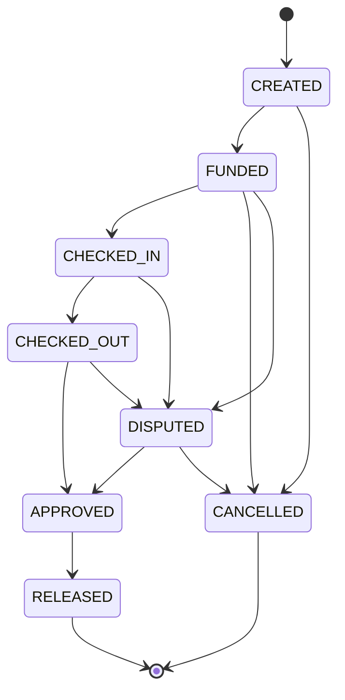

# WorkPulse – Escrow State Machine

## States

| State        | Description                                          |
|--------------|------------------------------------------------------|
| CREATED      | Escrow transaction created, awaiting funding         |
| FUNDED       | Contractor has deposited funds                       |
| CHECKED_IN   | Worker has checked in at the job site                |
| CHECKED_OUT  | Worker has checked out, awaiting approval            |
| APPROVED     | Contractor approved the work                         |
| RELEASED     | Funds released to the worker                         |
| DISPUTED     | Either party has raised a dispute                    |
| CANCELLED    | Transaction cancelled before completion              |

## Allowed Transitions

```
CREATED      → FUNDED, CANCELLED
FUNDED       → CHECKED_IN, CANCELLED, DISPUTED
CHECKED_IN   → CHECKED_OUT, DISPUTED
CHECKED_OUT  → APPROVED, DISPUTED
APPROVED     → RELEASED
DISPUTED     → APPROVED, CANCELLED
```

## State Diagram



## Rules

1. Only contractors can transition: CREATED → FUNDED, CHECKED_OUT → APPROVED, APPROVED → RELEASED
2. Only workers can transition: FUNDED → CHECKED_IN, CHECKED_IN → CHECKED_OUT
3. Either party can trigger: → DISPUTED
4. Admins can resolve: DISPUTED → APPROVED or DISPUTED → CANCELLED
5. Every transition creates a LedgerEntry (append-only audit trail)

<!-- TODO Phase 3: Implement the state machine engine in escrow.service.js -->
