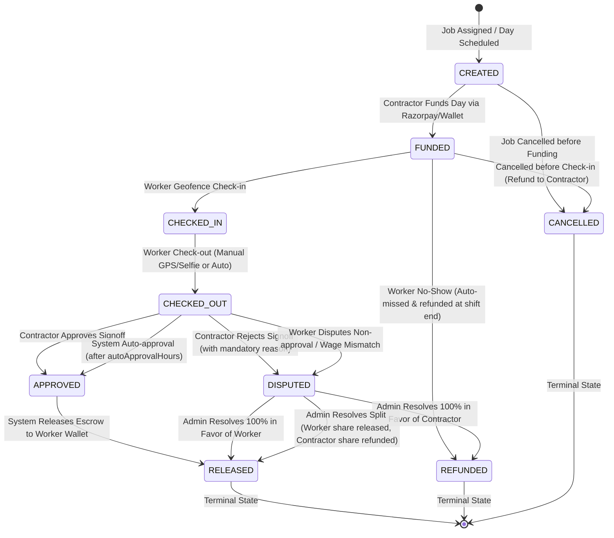

# WorkPulse Escrow State Machine & Double-Entry Ledger Specification

This document defines the formal lifecycle, transitions, transaction semantics, and double-entry ledger rules for daily worker escrow in WorkPulse.

---

## 1. Escrow Lifecycle State Diagram

Every escrow transaction corresponds to **one worker for one scheduled working day** (`job`, `worker`, `dayDate`).



---

## 2. Formal Transition Table

| Current State | Next State | Trigger Event | Triggered By | Preconditions | Side Effects & Ledger Actions | Failure Handling |
| :--- | :--- | :--- | :--- | :--- | :--- | :--- |
| **NONE** | `CREATED` | Job assignment finalized | System / Contractor | Job status = `FILLED` or `IN_PROGRESS`, worker active | Escrow doc created with `idempotencyKey`, status `CREATED`. No ledger move yet. | Abort job assignment if duplicate key. |
| `CREATED` | `FUNDED` | Day escrow funded | Contractor | Contractor wallet balance >= wage OR Razorpay order captured | 1. Lock funds in Contractor Wallet (`CONTRACTOR_WALLET` DEBIT -> `ESCROW_HOLD` CREDIT).<br>2. Notify worker: "Wage secured for [Date]".<br>3. Audit log recorded. | Rollback payment capture; keep state `CREATED`. |
| `CREATED` | `CANCELLED` | Job cancelled early | Contractor / Admin | Shift has not started, not funded | Escrow status set to `CANCELLED`. No monetary movement. | Log error if already funded. |
| `FUNDED` | `CHECKED_IN` | Worker arrival | Worker (System verified) | Current time within shift window (±30m); GPS within `geofenceRadiusMeters`; selfie valid | 1. Link `attendance` ref to escrow.<br>2. Socket alert to contractor.<br>3. Status history appended. | Reject check-in if GPS > geofence radius. |
| `FUNDED` | `CANCELLED` | Shift cancelled before arrival | Contractor / Admin | Attendance = null; cancelled > 2h before shift start | Reverse escrow hold: `ESCROW_HOLD` DEBIT -> `CONTRACTOR_WALLET` CREDIT. Status = `CANCELLED`. | Disallow if check-in already logged. |
| `FUNDED` | `REFUNDED` | Worker No-Show | System Cron | Shift ended; attendance status = `MISSED` | Reverse escrow hold: `ESCROW_HOLD` DEBIT -> `CONTRACTOR_WALLET` CREDIT. Status = `REFUNDED`. SMS alert to contractor. | Retry ledger reversal with idempotency. |
| `CHECKED_IN` | `CHECKED_OUT` | Shift conclusion | Worker / System | Check-in exists; hours worked calculated (min 1h) | 1. Calculate `autoApprovalAt` = now + `autoApprovalHours`.<br>2. Socket notification to contractor for sign-off. | Fallback to auto check-out if worker device dead. |
| `CHECKED_OUT` | `APPROVED` | Contractor Sign-off | Contractor | Contractor reviews attendance & hours worked | 1. `contractorSignoff.status` = `APPROVED`.<br>2. Trigger immediate payout release. | Concurrency check prevents double sign-off. |
| `CHECKED_OUT` | `APPROVED` | Auto-Approval Timer | System Cron Worker | `now()` >= `autoApprovalAt` and status == `CHECKED_OUT` | 1. Mark `contractorSignoff.status` = `APPROVED` (System-generated).<br>2. Trigger payout release. | Cron retries with distributed lock. |
| `CHECKED_OUT` | `DISPUTED` | Sign-off Rejection | Contractor | Rejection reason provided (min 10 chars); evidence photo optional | 1. Create `disputes` record.<br>2. Escrow status = `DISPUTED`.<br>3. Alert worker and system admin queue. | Keep `CHECKED_OUT` if reason missing. |
| `CHECKED_OUT` | `DISPUTED` | Worker Non-Payment | Worker | Payment withheld past window or amount deducted | 1. Create `disputes` record.<br>2. Escrow status = `DISPUTED`.<br>3. Admin alerted. | Disallow if already `APPROVED`. |
| `APPROVED` | `RELEASED` | Payout Execution | System Engine | Escrow status = `APPROVED` | 1. Double-entry ledger: `ESCROW_HOLD` DEBIT -> `WORKER_WALLET` CREDIT.<br>2. Worker balance increases.<br>3. SMS/Push notification.<br>4. Terminal state. | Retry ledger queue; lock worker wallet. |
| `DISPUTED` | `RELEASED` | Admin resolution (Worker 100%) | Admin | Admin audit completed | 1. `ESCROW_HOLD` DEBIT -> `WORKER_WALLET` CREDIT.<br>2. Dispute status = `RESOLVED_FOR_WORKER`.<br>3. Terminal state. | Admin action logged in `auditlogs`. |
| `DISPUTED` | `REFUNDED` | Admin resolution (Contractor 100%) | Admin | Admin audit completed | 1. `ESCROW_HOLD` DEBIT -> `CONTRACTOR_WALLET` CREDIT.<br>2. Dispute status = `RESOLVED_FOR_CONTRACTOR`.<br>3. Terminal state. | Admin action logged in `auditlogs`. |
| `DISPUTED` | `RELEASED` | Admin resolution (Split settlement) | Admin | `workerAmountPaise` + `contractorRefundPaise` == `amountPaise` | 1. `ESCROW_HOLD` DEBIT -> `WORKER_WALLET` CREDIT (`workerAmountPaise`).<br>2. `ESCROW_HOLD` DEBIT -> `CONTRACTOR_WALLET` CREDIT (`contractorRefundPaise`).<br>3. Dispute status = `SPLIT`. | Reject if split sums don't match total paise. |

---

## 3. Explicit Business & Escrow Rules

### Rule 1: Funding Before Check-in Invariant
A worker cannot check in unless the day's `escrowtransactions` document is in state `FUNDED`. If un-funded, the check-in API returns `400 Bad Request` (`ESCROW_NOT_FUNDED`), protecting workers from doing unbacked labor.

### Rule 2: Server-Side Geofence Validation
Check-in and check-out coordinates are checked strictly on the backend using Haversine distance formula:
$$\text{distance}(\text{workerLoc}, \text{jobLoc}) \le \text{geofenceRadiusMeters}$$
If GPS distance exceeds the radius, the status remains unchanged and an error `GEOFENCE_EXCEEDED` is returned.

### Rule 3: Auto-Approval Timer
If a contractor does not explicitly approve or dispute within `autoApprovalHours` (default 12 hours) from `CHECKED_OUT`:
- The background cron worker flags the escrow `APPROVED`.
- Funds are automatically transferred to the worker's wallet without requiring further human intervention.

### Rule 4: Mandatory Dispute Justification
A contractor cannot reject signoff without a detailed reason enum (`NOT_APPROVED`, `WAGE_MISMATCH`, `ATTENDANCE_DENIED`, `WORK_QUALITY`, `OTHER`) and descriptive notes. Once disputed, the contractor cannot unilaterally reclaim funds.

### Rule 5: Terminal States
The states `RELEASED`, `REFUNDED`, and `CANCELLED` are terminal. No further state transitions are permitted once reached.

### Rule 6: Forgotten Check-out Handling
If a worker checks in but fails to check out by 23:59 of that day:
- The system executes an **Auto Check-Out** with flag `deviceInfo.autoCheckOut = true`.
- Hours worked are capped at the job's defined `workingHours`.
- Auto-approval timer starts from the auto-checkout timestamp.

### Rule 7: No-Show Worker Auto-Refund
If a day ends (23:59:59) and the escrow is `FUNDED` but no check-in was ever logged:
- Attendance is recorded as `MISSED`.
- Escrow transitions to `REFUNDED`.
- Held funds return from `ESCROW_HOLD` to `CONTRACTOR_WALLET`.

### Rule 8: Idempotency Protection
Every money movement operation requires an `idempotencyKey` formatted as:
`ESCROW_{TRANS_ID}_{TRIGGER_ACTION}` (e.g., `ESCROW_652a1b9c_RELEASE`).
Subsequent invocations with the same key will return the cached result without creating ledger entries.

### Rule 9: Atomic Concurrency Control
State transitions must be executed using atomic document updates:
```javascript
const updated = await EscrowTransaction.findOneAndUpdate(
  { _id: transactionId, status: expectedCurrentStatus },
  { 
    $set: { status: newStatus },
    $push: { statusHistory: { from: expectedCurrentStatus, to: newStatus, by: userId, at: new Date(), reason } }
  },
  { new: true }
);
if (!updated) {
  throw new Error("CONFLICT: Escrow transaction has already transitioned or invalid state");
}
```

---

## 4. Double-Entry Ledger Bookkeeping Examples

## 4. Double-Entry Ledger Bookkeeping Templates

All ledger transactions are strictly append-only. Each economic event has a matching set of **DEBIT** and **CREDIT** entries sharing a deterministic, unique `groupId`.

### 1. TOPUP (`TOPUP:<paymentId>`)
- Contractor adds funds to their wallet via Razorpay / Mock gateway (₹5,000 = 500,000 Paise).
- **groupId:** `TOPUP:pay_mock_12345`

```
Entry 0:
  Account:       GATEWAY_EXTERNAL
  EntryType:     DEBIT
  AmountPaise:   500000
  Wallet:        null
  BalanceAfter:  0
  Description:   "Contractor wallet top-up via gateway"

Entry 1:
  Account:       CONTRACTOR_WALLET
  EntryType:     CREDIT
  AmountPaise:   500000
  Wallet:        Wallet_Contractor_01
  BalanceAfter:  500000
  Description:   "Contractor wallet credited with top-up"
```
*Invariant:* $\sum \text{DEBIT} (500,000) == \sum \text{CREDIT} (500,000)$.

---

### 2. FUND (`FUND:<txId>`)
- Contractor locks money in escrow for 1 worker shift (₹800 = 80,000 Paise).
- **groupId:** `FUND:6ad6f48f017febc154631683`

```
Entry 0:
  Account:       CONTRACTOR_WALLET
  EntryType:     DEBIT
  AmountPaise:   80000
  Wallet:        Wallet_Contractor_01
  BalanceAfter:  420000 (usable available balance drops)
  Description:   "Locked daily wage in escrow for worker Ramesh"

Entry 1:
  Account:       ESCROW_HOLD
  EntryType:     CREDIT
  AmountPaise:   80000
  Wallet:        Wallet_Contractor_01
  BalanceAfter:  80000 (contractor locked balance increases)
  Description:   "Escrow hold secured for worker Ramesh"
```
*Invariant:* $\sum \text{DEBIT} (80,000) == \sum \text{CREDIT} (80,000)$.

---

### 3. RELEASE (`RELEASE:<txId>`)
- Shift completed & approved. Escrow released to worker wallet. (₹800 = 80,000 Paise with optional 5% platform fee = 4,000 Paise).
- **groupId:** `RELEASE:6ad6f48f017febc154631683`

```
Entry 0:
  Account:       ESCROW_HOLD
  EntryType:     DEBIT
  AmountPaise:   80000
  Wallet:        Wallet_Contractor_01
  BalanceAfter:  0 (contractor locked balance drops)
  Description:   "Escrow hold released for worker Ramesh"

Entry 1:
  Account:       WORKER_WALLET
  EntryType:     CREDIT
  AmountPaise:   76000 (Amount minus fee)
  Wallet:        Wallet_Worker_01
  BalanceAfter:  76000
  Description:   "Shift wage credited to worker"

Entry 2 (only if PLATFORM_FEE_PERCENT > 0):
  Account:       PLATFORM_FEE
  EntryType:     CREDIT
  AmountPaise:   4000
  Wallet:        null
  BalanceAfter:  0
  Description:   "Platform facilitation fee on wage"
```
*Invariant:* $\text{DEBIT } (80,000) == \text{CREDIT } (76,000 + 4,000 = 80,000)$.

---

### 4. REFUND (`REFUND:<txId>`)
- Worker no-show (MISSED) or shift cancelled before check-in. Held funds returned to contractor wallet.
- **groupId:** `REFUND:6ad6f48f017febc154631683`

```
Entry 0:
  Account:       ESCROW_HOLD
  EntryType:     DEBIT
  AmountPaise:   80000
  Wallet:        Wallet_Contractor_01
  BalanceAfter:  0 (locked balance drops)
  Description:   "Escrow hold refunded to contractor"

Entry 1:
  Account:       CONTRACTOR_WALLET
  EntryType:     CREDIT
  AmountPaise:   80000
  Wallet:        Wallet_Contractor_01
  BalanceAfter:  500000 (available balance restored)
  Description:   "Refund of escrow hold for unperformed shift"
```
*Invariant:* $\sum \text{DEBIT} (80,000) == \sum \text{CREDIT} (80,000)$.

---

### 5. SPLIT (`SPLIT:<disputeId>`)
- Admin arbitrates dispute with partial settlement: ₹500 (50,000 Paise) to Worker, ₹300 (30,000 Paise) refund to Contractor.
- **groupId:** `SPLIT:6ad6f49d44712b52aa47cabf`

```
Entry 0:
  Account:       ESCROW_HOLD
  EntryType:     DEBIT
  AmountPaise:   80000
  Wallet:        Wallet_Contractor_01
  BalanceAfter:  0
  Description:   "Dispute split resolution: hold relief"

Entry 1:
  Account:       WORKER_WALLET
  EntryType:     CREDIT
  AmountPaise:   50000
  Wallet:        Wallet_Worker_01
  BalanceAfter:  50000
  Description:   "Dispute arbitrated wage payout"

Entry 2:
  Account:       CONTRACTOR_WALLET
  EntryType:     CREDIT
  AmountPaise:   30000
  Wallet:        Wallet_Contractor_01
  BalanceAfter:  450000
  Description:   "Dispute arbitrated contractor refund"
```
*Invariant:* $\text{DEBIT } (80,000) == \text{CREDIT } (50,000 + 30,000 = 80,000)$. Sum of worker amount and contractor refund must equal escrow amount exactly.

---

### 6. PAYOUT (`PAYOUT:<payoutId>`)
- Worker receives simulated UPI payout to their bank account (₹760 = 76,000 Paise).
- **groupId:** `PAYOUT:6ad6f4a21147febc154631683`

```
Entry 0:
  Account:       WORKER_WALLET
  EntryType:     DEBIT
  AmountPaise:   76000
  Wallet:        Wallet_Worker_01
  BalanceAfter:  0
  Description:   "Worker UPI payout transfer"

Entry 1:
  Account:       PAYOUT_EXTERNAL
  EntryType:     CREDIT
  AmountPaise:   76000
  Wallet:        null
  BalanceAfter:  0
  Description:   "Dispatched to bank/UPI network"
```
*Invariant:* $\sum \text{DEBIT} (76,000) == \sum \text{CREDIT} (76,000)$.

---

### 7. PAYOUT_REVERSAL (`PAYOUT_REVERSAL:<payoutId>`)
- Bank rejects UPI payout (e.g., invalid VPA or network failure). Funds restored to worker wallet.
- **groupId:** `PAYOUT_REVERSAL:6ad6f4a21147febc154631683`

```
Entry 0:
  Account:       PAYOUT_EXTERNAL
  EntryType:     DEBIT
  AmountPaise:   76000
  Wallet:        null
  BalanceAfter:  0
  Description:   "Reversal of failed UPI transfer"

Entry 1:
  Account:       WORKER_WALLET
  EntryType:     CREDIT
  AmountPaise:   76000
  Wallet:        Wallet_Worker_01
  BalanceAfter:  76000
  Description:   "Restored failed payout to worker wallet"
```
*Invariant:* $\sum \text{DEBIT} (76,000) == \sum \text{CREDIT} (76,000)$.

---

## 5. Invalid Transitions & Error Codes

Any attempt to execute an invalid transition is immediately rejected by the state validator:

| Requested Transition | Why It Is Invalid | HTTP Status | Error Code |
| :--- | :--- | :--- | :--- |
| `CREATED` -> `CHECKED_IN` | Cannot check in without funding escrow | 400 | `ESCROW_NOT_FUNDED` |
| `FUNDED` -> `RELEASED` | Cannot bypass attendance check-in & check-out | 400 | `INVALID_TRANSITION_SEQUENCE` |
| `CHECKED_IN` -> `RELEASED` | Cannot release without check-out and sign-off | 400 | `ATTENDANCE_NOT_CHECKED_OUT` |
| `RELEASED` -> Any | Terminal state; funds already disbursed | 409 | `TERMINAL_STATE_IMMUTABLE` |
| `REFUNDED` -> Any | Terminal state; funds already returned | 409 | `TERMINAL_STATE_IMMUTABLE` |
| `CANCELLED` -> `FUNDED` | Cancelled jobs cannot be funded | 400 | `TRANSACTION_CANCELLED` |
| `CHECKED_OUT` -> `REFUNDED` | Cannot refund directly without Dispute resolution | 400 | `DISPUTE_REQUIRED_FOR_REFUND` |
| `DISPUTED` -> `APPROVED` | Disputed escrow must be decided by Admin resolution | 403 | `ADMIN_RESOLUTION_REQUIRED` |
| Any -> Any (wrong key) | Replay with duplicate or conflicting idempotency key | 409 | `IDEMPOTENCY_CONFLICT` |
