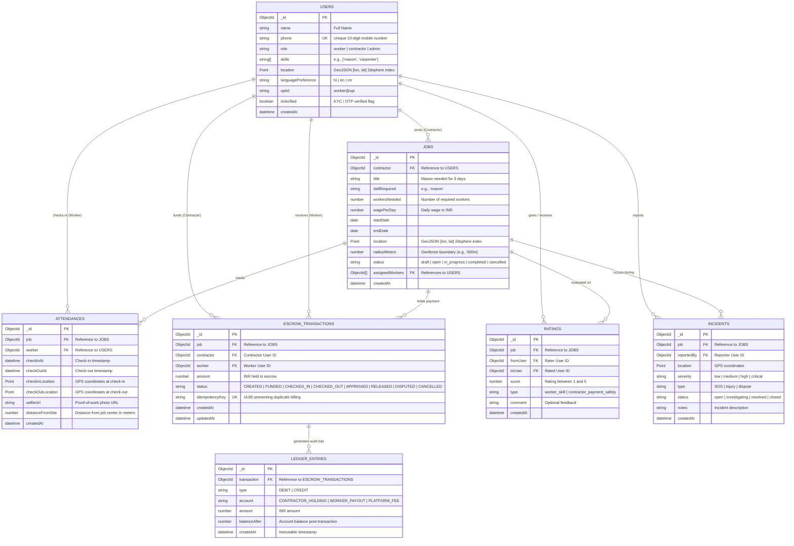
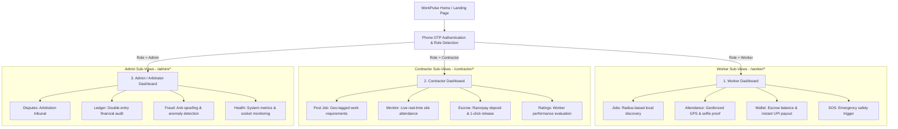
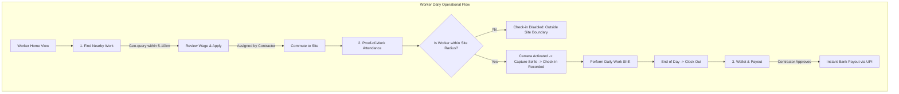
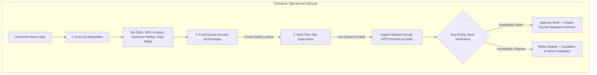
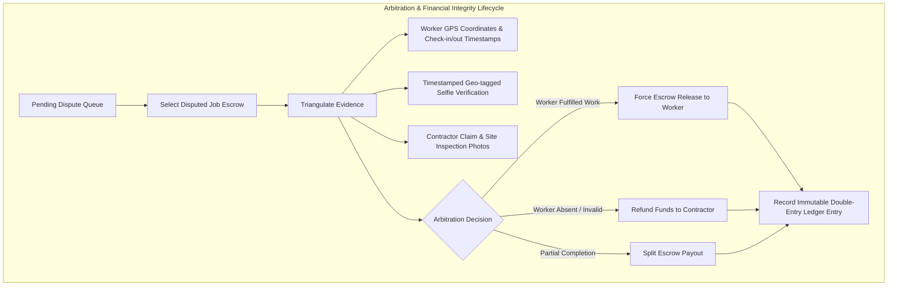

# WorkPulse – Roles, Dashboards & ER Architecture (English)

---

## 1. Platform Roles

WorkPulse is architected around **three primary roles**:

| Role | Target Persona | Key Responsibilities & Value Proposition |
|---|---|---|
| **1. Worker** | Daily-wage laborers, masons, carpenters, plumbers, electricians, loaders | • Discover nearby work within a geo-radius. • Voice-based search and profile creation. • Geofenced GPS check-in/out with selfie proof-of-work. • Instant, guaranteed daily payout via UPI upon approval. |
| **2. Contractor** | Sub-contractors, civil engineers, site supervisors, individual homeowners | • Post job specifications (skill, workers required, wage, site radius). • Lock payments in escrow (via Razorpay) before work commences. • Monitor real-time worker arrivals and selfie verifications. • 1-click escrow approval/release or dispute raising. |
| **3. Admin / Arbitrator** | WorkPulse platform operations, support and dispute resolution officers | • Audit and arbitrate disputed escrow funds using GPS and selfie evidence. • Detect and prevent GPS spoofing, mock locations, or abuse. • Maintain the append-only double-entry financial ledger. |

---

## 2. Complete Entity-Relationship (ER) Diagram

---

## 3. High-Level Dashboard Navigation Architecture

---

## 4. Dashboard 1: Worker Dashboard (`/worker/dashboard`)

### Key Capabilities:
* **Large Touch Targets (min 48px)**: Designed for one-handed operation on low-cost Android smartphones.
* **Geofence Enforcement**: Workers can only check in if their device GPS coordinates are within the configured job boundary (e.g., 500m).
* **Voice-First Search (Phase 5)**: Workers can speak in Hindi, Marathi, or English to find matching jobs.
* **One-Tap Emergency SOS**: Immediately transmits live GPS coordinates and contacts site supervisor and platform response teams.

---

## 5. Dashboard 2: Contractor Dashboard (`/contractor/dashboard`)

### Key Capabilities:
* **Geofence Job Definition**: Contractors drop a pin on a map and specify an allowable radius (e.g., 500 meters).
* **Guaranteed Escrow Protection**: Contractors deposit funds upfront, building trust with daily workers without risking unearned disbursement.
* **Live Site Supervision**: Real-time websocket stream of checked-in workers, arrival times, and timestamped selfie verification photos.
* **Frictionless Payout Approval**: 1-click end-of-day release, eliminating manual cash handoffs.

---

## 6. Dashboard 3: Admin & Dispute Dashboard (`/admin/dashboard`)

### Key Capabilities:
* **Evidence-Based Arbitration**: Resolves disputes impartially by cross-referencing worker GPS logs, device accuracy, and verified selfies against contractor claims.
* **Immutable Double-Entry Ledger**: Every state transition (CREATED, FUNDED, APPROVED, RELEASED, REFUNDED) generates an immutable, append-only ledger transaction.
* **Anti-Spoofing & Fraud Detection**: Flags simulated GPS apps, unrealistic commute velocities, or duplicate identities.
