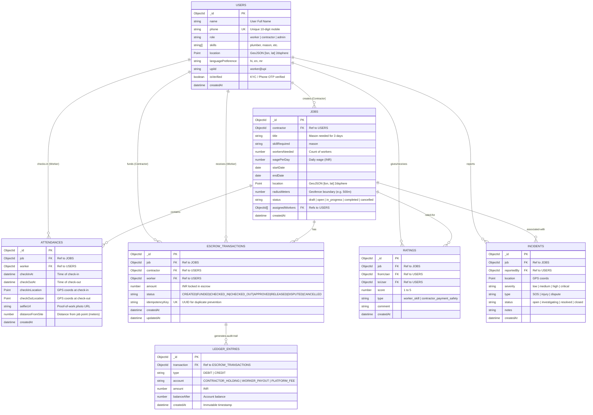
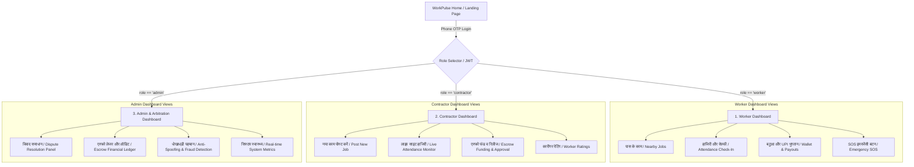
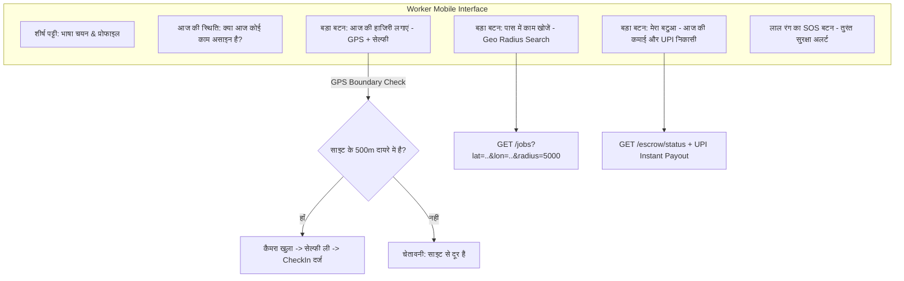
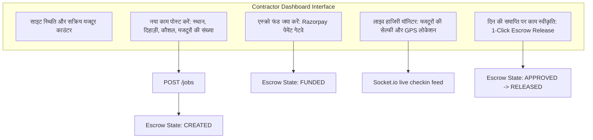
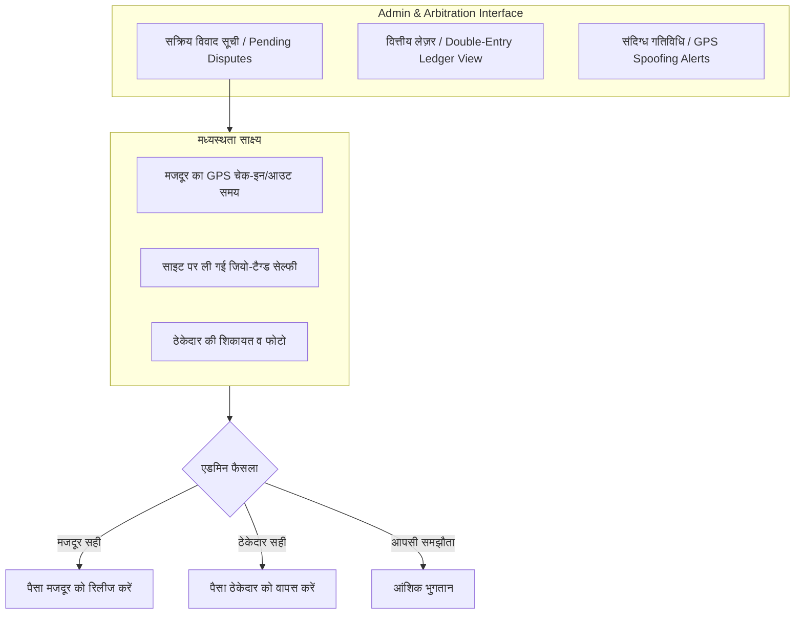

# WorkPulse – Roles, Dashboards & ER Diagrams

---

## 1. Project Roles (भूमिकाएं)

WorkPulse प्लेटफ़ॉर्म पर मुख्य रूप से **3 प्राथमिक भूमिकाएं (Roles)** हैं:

| Role (भूमिका) | विवरण (Description) | प्राथमिक लक्ष्य (Primary Goal) |
|---|---|---|
| **1. Worker (मजदूर / कारीगर)** | दिहाड़ी मजदूर, मिस्त्री, बढ़ई, इलेक्ट्रीशियन, प्लंबर आदि | पास में काम ढूंढना, हाजिरी लगाना और काम खत्म होते ही गारंटीड UPI भुगतान पाना। |
| **2. Contractor (ठेकेदार / मालिक)** | छोटे बिल्डर, पेटी ठेकेदार, साइट सुपरवाइजर | सत्यापित मजदूर पाना, साइट पर उपस्थिति की पुष्टि करना और सुरक्षित एस्क्रो फंड करना। |
| **3. Admin / Arbitrator (व्यवस्थापक / मध्यस्थ)** | WorkPulse ऑपरेशंस टीम, कानूनी/विवाद समाधान अधिकारी | विवादों की जांच (GPS + सेल्फी साक्ष्य), प्लेटफॉर्म सुरक्षा, और फर्जीवाड़े की रोकथाम। |

---

## 2. Complete ER Diagram (डेटाबेस संबंध चित्र)

---

## 3. Dashboards Architecture (डैशबोर्ड संरचना)

WorkPulse में कुल **3 अलग-अलग Dashboards** हैं:

---

## 4. Dashboard 1: Worker Dashboard (`/worker/dashboard`)

### मुख्य फीचर्स:
1. **एक-क्लिक GPS हाजिरी**: जब मजदूर साइट पर पहुंचता है, तो GPS दूरी चेक होती है और सेल्फी प्रूफ अपलोड होता है।
2. **आवाज आधारित सर्च (Phase 5)**: बिना टाइप किए बोलकर काम खोजना।
3. **तुरंत UPI ट्रांसफर**: ठेकेदार द्वारा काम स्वीकृत करते ही सीधे मजदूर के UPI खाते में पैसा पहुंचना।
4. **इमरजेंसी SOS**: किसी भी दुर्घटना या विवाद की स्थिति में तुरंत लोकेशन ब्रॉडकास्ट।

---

## 5. Dashboard 2: Contractor Dashboard (`/contractor/dashboard`)

### मुख्य फीचर्स:
1. **काम पोस्टिंग विज़ार्ड**: नक्शे पर पिन लगाकर साइट का घेरा (500m/1km) और दैनिक मजदूरी तय करना।
2. **एस्क्रो लॉकिंग**: ठेकेदार का पैसा पहले ही सुरक्षित एस्क्रो में जमा हो जाता है, जिससे मजदूर को भुगतान की 100% गारंटी मिलती है।
3. **लाइव उपस्थिति स्क्रीन**: ठेकेदार देख सकता है कि कौन-सा मजदूर किस समय साइट पर आया और उसकी सेल्फी क्या है।
4. **अप्रूवल या विवाद**: काम पूरा होने पर तुरंत पैसा रिलीज करें या समस्या होने पर विवाद उठाएं।

---

## 6. Dashboard 3: Admin & Dispute Dashboard (`/admin/dashboard`)

### मुख्य फीचर्स:
1. **पारदर्शी साक्ष्य केंद्र (Evidence Center)**: दोनों पक्षों की लोकेशन टाइमस्टैम्प, सेल्फी और काम के फोटो की तुलना।
2. **ऑडिट लेज़र (Immutable Ledger)**: पाई-पाई का हिसाब रखने वाला अपरिवर्तनीय लेज़र।
3. **धोखाधड़ी चेतावनी (Anti-Fraud)**: नकली GPS (Mock location) या बार-बार विवाद करने वाले खातों को फ्लैग/ब्लॉक करना।
