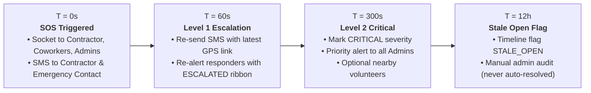

# WorkPulse: Safety, Reputation & Incident Management (Phase 7)

This document specifies the operational design, mathematical formulations, privacy architectures, and legal constraints governing two-way ratings, contractor trust metrics, and emergency SOS incident dispatch on the WorkPulse platform.

---

## 1. Two-Way Ratings & Eligibility Matrix

WorkPulse enforces that **reputation can only be earned through verified, real-world work**. Subjective feedback is strictly decoupled from arbitrary reviews by gating eligibility behind verified attendance and escrow settlement.

### 1.1 Rating Eligibility Table

| Review Direction | Rating Type | Prerequisites & Conditions | Rating Window | Allowed Tags |
| :--- | :--- | :--- | :--- | :--- |
| **Contractor &rarr; Worker** | `WORKER_SKILL` | Worker must have **$\ge 1$ attendance record with status `CHECKED_OUT`** on the specified job (`MISSED` does not qualify). | Opens when job is `COMPLETED` or `endDate` passes. Closes 14 days later. | `ON_TIME`, `GOOD_WORK`, `HARD_WORKING`, `HONEST`, `TEAMWORK`, `NEEDS_SUPERVISION`, `LATE` |
| **Worker &rarr; Contractor** | `CONTRACTOR_SAFETY` | Worker must have **$\ge 1$ attendance record with status `CHECKED_OUT`** on the site. | Opens when job is `COMPLETED` or `endDate` passes. Closes 14 days later. | `SAFETY_GEAR_GIVEN`, `SAFE_SITE`, `RESPECTFUL`, `NO_ABUSE`, `UNSAFE_SITE`, `ABUSIVE_LANGUAGE` |
| **Worker &rarr; Contractor** | `CONTRACTOR_PAYMENT` | Worker must have **$\ge 1$ settled escrow row** on the job in terminal state (`RELEASED`, `REFUNDED`, or `DISPUTED`). Rating payment behavior is blocked while funds are still held. | Opens when job is `COMPLETED` or `endDate` passes. Closes 14 days later. | `PAID_ON_TIME`, `PAID_FULL_AMOUNT`, `PAYMENT_DELAYED`, `AMOUNT_CUT`, `FAIR_SIGNOFF` |

- **Self-Rating**: Blocked (HTTP 403 `NOT_JOB_PARTICIPANT`).
- **Stranger Rating**: Blocked (HTTP 403 `NOT_JOB_PARTICIPANT`).
- **Window Enforcement**: Rating outside the 14-day window is rejected (HTTP 409 `RATING_NOT_OPEN` / `RATING_WINDOW_CLOSED`). Dev mode allows instant testing via `DEV_RATING_ALLOW_ANYTIME=true`.
- **Immutability**: Once created, `score`, `type`, `job`, `fromUser`, and `toUser` are immutable. Ratings cannot be edited.

---

## 2. Double-Blind Rating Architecture

### 2.1 The Retaliation Problem
In traditional gig platforms, workers who report delayed payment, missing safety gear, or abusive conduct face instant retaliation: the contractor gives them a 1-star review, ruining their livelihood. As a result, workers stay silent and bad contractors maintain inflated ratings.

### 2.2 Double-Blind Reveal Mechanism
To prevent retaliatory ratings:
1. When either party submits a review, the document is saved with `revealedAt: null`.
2. **Zero Information Leak**: The recipient cannot view the score, author, or comments in `GET /ratings/received`, and public summaries (`GET /users/:id/reputation`) exclude unrevealed ratings.
3. **Atomic Mutual Reveal**: When:
   - The contractor has rated the worker's skill (`WORKER_SKILL`), **AND**
   - The worker has rated the contractor on at least one category (`CONTRACTOR_PAYMENT` or `CONTRACTOR_SAFETY`),
   the system executes an atomic `updateMany({ revealedAt: null }, { $set: { revealedAt: new Date() } })` across all ratings for that `(job, worker)` pair.
4. **Window Expiry Fallback**: If one party rates but the counterparty does not, pending ratings are automatically revealed when the 14-day window closes by `revealClosedWindows()`.

---

## 3. Bayesian Rating Smoothing & Formula

### 3.1 The Low-Volume Bias Problem
Arithmetic averages ($S = \frac{\sum R}{N}$) fail in direct contracting:
- A new worker with a single 5-star rating achieves an average of `5.0`.
- A trusted worker with 40 jobs and an average of `4.85` appears lower-ranked than a completely unproven newcomer.
- A single malicious 1-star rating drops a new worker to `1.0`, permanently locking them out of the platform.

### 3.2 The Bayesian Formula
WorkPulse applies Bayesian smoothing using prior beliefs:
$$\text{Smoothed Score} = \frac{C \cdot M + \sum_{i=1}^N R_i}{C + N}$$

Where:
- $C = \text{RATING\_PRIOR\_COUNT} = 3$ (virtual prior ratings)
- $M = \text{RATING\_PRIOR\_MEAN} = 4.0$ (platform baseline expectation)
- $N = \text{Total revealed, non-hidden ratings}$
- $\sum R = \text{Sum of scores}$

### 3.3 Worked Examples

#### Example 1: New Worker with One 5-Star Rating
- Unsmoothed Average: $\frac{5}{1} = 5.0$
- Bayesian Calculation:
  $$\text{Score} = \frac{(3 \times 4.0) + 5}{3 + 1} = \frac{12 + 5}{4} = \frac{17}{4} = 4.25$$
- Badge: `NEW` (because $N < 3$, protecting contractors from over-indexing on small samples).

#### Example 2: Veteran Worker with Thirty 5-Star and Two 4-Star Ratings
- Total count $N = 32$, Sum $= (30 \times 5) + (2 \times 4) = 158$.
- Unsmoothed Average: $\frac{158}{32} \approx 4.94$
- Bayesian Calculation:
  $$\text{Score} = \frac{(3 \times 4.0) + 158}{3 + 32} = \frac{12 + 158}{35} = \frac{170}{35} \approx 4.86$$
- Badge: `GOOD` (proven, resilient track record).

#### Example 3: Single Unfair 1-Star Rating on New User
- Unsmoothed Average: $1.0$ (devastating).
- Bayesian Calculation:
  $$\text{Score} = \frac{(3 \times 4.0) + 1}{3 + 1} = \frac{12 + 1}{4} = 3.25$$
- The prior cushions the blow, preventing platform lockout while moderation reviews the dispute.

---

## 4. Objective Contractor Trust Metrics

Subjective star ratings are vulnerable to grade inflation. WorkPulse pairs subjective feedback with **verifiable, objective numbers directly aggregated from financial escrow records**:

| Metric | Source Collection | Definition & Plain-Hindi Translation |
| :--- | :--- | :--- |
| `workerDaysTotal` | `escrowtransactions` | Total worker-days contracted by this contractor. |
| `escrowRowsSettled` | `escrowtransactions` | Completed daily shifts (`RELEASED` / `REFUNDED` / `DISPUTED`). |
| `approvedByContractorCount` | `escrowtransactions` | Shifts manually reviewed and approved on time by the contractor. |
| `autoApprovedCount` | `escrowtransactions` | Shifts where contractor was silent and system auto-released funds. *(High number = contractor routinely ignores sign-offs)*. |
| `disputesOpenedAgainst` | `disputes` | Total formal wage disputes filed by workers against this contractor. |
| `disputesResolvedForWorker`| `disputes` | Wage disputes where platform arbitrator ruled in the worker's favor. |
| `avgApprovalHours` | `attendances` & `escrows` | Average hours taken by contractor to approve sign-off after check-out. |
| `incidentsReported` | `incidents` | Safety incidents (`SOS` or `INJURY`) on the contractor's job sites. |
| `incidentsPer100WorkerDays`| Aggregated ratio | Safety incident frequency normalized per 100 worker-days. |
| `sampleTooSmall` | Boolean flag | Set to `true` when `workerDaysTotal < 5`. UI displays *"Naya contractor, abhi kam data hai"* instead of misleading percentages. |

> **Documented Governance Rule**: These metrics describe past platform behavior; they are NOT automatic bans or financial penalties. Humans (workers, contractors, admins) review the data to make informed hiring decisions.

---

## 5. Emergency SOS: Zero-Failure Architecture

WorkPulse treats emergency SOS as a **mission-critical safety primitive**. An SOS alert must NEVER fail due to poor GPS, network retry collisions, or client panic.

### 5.1 Trigger & Accidental Prevention
1. **2-Second Hold**: Worker must hold the floating red SOS button for 2 seconds (circular SVG progress ring fills, haptic vibration pulses). Accidental screen taps do nothing.
2. **5-Second Cancel Countdown**: A full-screen overlay opens with a live 5-second countdown and a 56px tactile *"Rok dein (Cancel)"* button.
3. **Contractor Privacy Toggle**: The overlay includes a *"Contractor ko bhi batayein"* checkbox (default ON). If the threat originates from the contractor, the worker unchecks it before sending.

### 5.2 Zero-Failure Location Fallback
- PWA requests a high-accuracy GPS fix with a strict **4-second timeout**.
- If GPS is slow or indoor reception is weak, it falls back to the worker's last known position (`users.location` or last attendance) with `locationFlag: STALE`.
- If GPS is completely denied or unavailable, the alert is STILL stored and dispatched with `locationFlag: MISSING`. **Missing GPS never rejects an SOS.**

### 5.3 Idempotency & Network Retries
- PWA generates a client-side UUID `idempotencyKey` once when the countdown finishes.
- If the cellular connection drops and retries 5 times, the server detects the `(reportedBy, idempotencyKey)` pair and returns `200 OK { alreadyExists: true }` without duplicating SMS or sockets.
- If the user creates multiple alerts within 120 seconds (`SOS_DEDUPE_WINDOW_SEC`), the server updates the existing open incident with a `LOCATION_UPDATE` instead of fragmenting the incident queue.

### 5.4 Escalation Timeline

---

## 6. Incident Reporting & Privacy Boundaries

### 6.1 Visibility Matrix by Incident Type

| Incident Type | Default Visibility | Alerted Parties | Contractor Access |
| :--- | :--- | :--- | :--- |
| **`SOS`** | `ALERTED_USERS` | Contractor (if `notifyContractor=true`), same-job coworkers (up to 10), Emergency contact (SMS), platform Admins. | Visible on job incident tab; receive socket & SMS. |
| **`INJURY`** | `ALERTED_USERS` | Contractor of that job and platform Admins. | Visible on job incident tab. |
| **`HARASSMENT`**| **`ADMIN_ONLY`** | **Platform Admins ONLY**. The contractor and coworkers are NEVER notified and get HTTP 403/404 if attempting to read the incident ID. | **BLOCKED (Zero access)**. |
| **`DISPUTE`** | **`ADMIN_ONLY`** | **Platform Admins ONLY**. | **BLOCKED (Zero access)**. |
| **`OTHER`** | `ALERTED_USERS` | Contractor and Admins. | Visible on job incident tab. |

### 6.2 Photo Evidence Storage & Serving
- Photos attached to incidents reuse Phase 4 selfie security protocols:
  - In-memory upload buffer (max 3 photos, size $\le$ 5MB).
  - Magic byte validation (`image/jpeg`, `image/png`, `image/webp`).
  - Stored in a private, unguessable storage directory outside the public web root.
  - Served strictly through authenticated endpoint `GET /incidents/:id/photos/:index`, accessible only by the reporter, platform admins, and verified alerted responders.

---

## 7. DPDP Act 2023 Compliance & Ethical Considerations

1. **Digital Personal Data Protection (DPDP) Act 2023**:
   - **Emergency Contact Consent**: When a worker registers an emergency contact, an automated notice SMS is sent: *"Aapko WorkPulse par emergency contact banaya hai. Agar woh SOS dabayenge toh aapko SMS aayega."*
   - **Phone Number Masking**: Public reputation endpoints (`GET /users/:id/reputation`) NEVER expose phone numbers. Responders who are not direct coworkers on the same job never receive the reporter's phone number.
   - **Nearby Volunteers Privacy**: The `SOS_NEARBY_VOLUNTEERS` flag is disabled by default (`false`). Broadcasting location to strangers creates stalking and physical safety hazards. If enabled in future municipal trials, volunteers receive first names only, no phone numbers, and location coordinates are rounded to 100 meters.
2. **False Alarms**:
   - The platform tracks `falseAlarmCount` in the admin incident viewer as contextual information for arbitration.
   - **No Automatic Penalties**: False alarms do not automatically ban or fine workers, because fear of penalties discourages workers from pressing SOS in genuine life-threatening emergencies.

---

## 8. Honest System Limitations

WorkPulse is a software tool, not an emergency services dispatch agency. System documentation and UI explicitly communicate these real-world limits:

1. **App Is Not 112/108 Replacement**:
   - The WorkPulse SOS screen provides prominent tap-to-call buttons for **112 (National Emergency Helpline)** and **108 (Ambulance)**. Software alerts run parallel to, never instead of, calling the police or emergency services.
2. **SMS Delivery Is Best-Effort**:
   - Indian telecom regulations require DLT (Distributed Ledger Technology) registered templates for transactional SMS. SMS delivery depends on telecom tower congestion, DND registry settings, and carrier latency.
3. **No Web Push / FCM**:
   - Push notifications via Firebase Cloud Messaging or Web Push require native browser service workers with persistent Google Play Services connections, which frequently fail on low-cost Android Go devices. Sockets and SMS provide the primary delivery channels.
4. **Ratings Require Volume**:
   - Bayesian smoothing prevents extreme distortions on small sample sizes, but true reputation metrics require at least 5 to 10 verified jobs before statistical confidence is reached.
