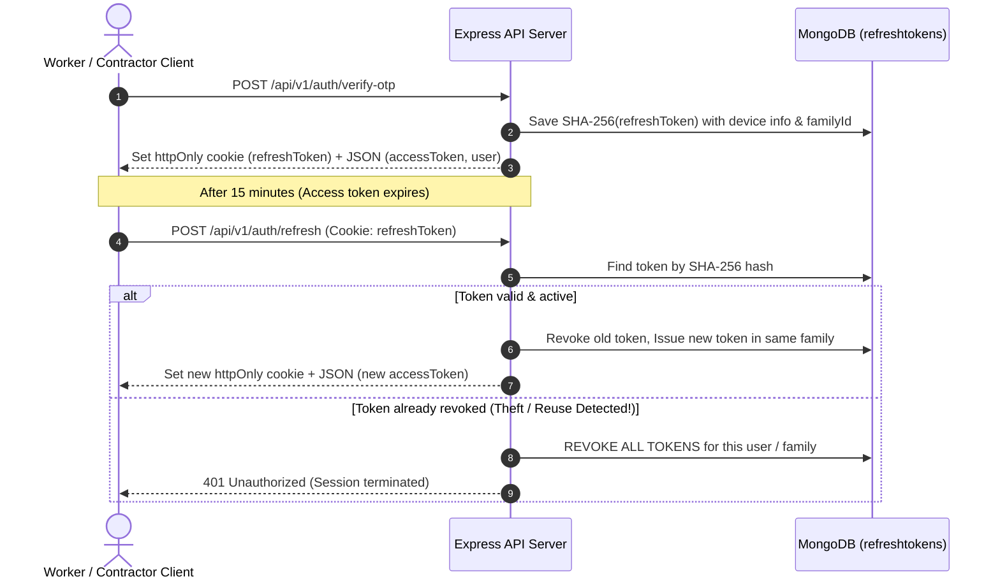

# WorkPulse Security Architecture & Hardening Report (Phase 8)

**Date**: 2026-10-22  
**Status**: Feature Freeze Hardening Verified  
**Scope**: Backend API, Authentication, Financial Ledger, Gateway, Frontend Resiliency  

---

## 1. Authentication & Session Architecture

### 1.1 Dual-Token Model with Sliding Rotation
In Phase 8, the single long-lived JWT architecture was upgraded to a dual-token system with rotation and session theft detection:
- **Access Token**:
  - Lifespan: **15 minutes**
  - Stored: In-memory only in the client state (Zustand `authStore.js`).
  - Transmission: `Authorization: Bearer <token>` header.
- **Refresh Token**:
  - Lifespan: Configured via `REFRESH_TOKEN_EXPIRES_IN_DAYS` (default: 7 days sliding).
  - Stored on Client: Secure `httpOnly`, `sameSite: 'lax'`, `path: '/api/v1/auth'` cookie.
  - Stored in Database: SHA-256 hashed in the `refreshtokens` collection (never in plaintext).
  - TTL Index: Mongo TTL index cleans up expired tokens automatically.

### 1.2 Token Reuse & Hijacking Detection
- Every refresh token belongs to a cryptographically random `familyId`.
- When a refresh token is used, it is immediately marked as `isRevoked: true` and replaced by a successor token.
- If a revoked token is ever presented again, the security middleware assumes the token was intercepted by an attacker and **instantly revokes all active sessions for that user family**, forcing re-authentication across all devices.

---

## 2. Production Safety Invariants (`backend/src/config/env.js`)

The server enforces startup-time assertion checks. If `NODE_ENV === 'production'`, the server throws a fatal error and refuses to start under any of the following conditions:
1. `OTP_DEV_MODE === 'true'`: Dev OTP bypass must be disabled.
2. `DEV_LOGIN_ENABLED === 'true'`: Dev login endpoints (`/dev-login`, `/dev-users`) must not be accessible.
3. Default or placeholder secrets detected:
   - `JWT_SECRET` equals default development string.
   - `REFRESH_TOKEN_SECRET` equals default development string.
   - `ENCRYPTION_KEY` equals default development string.
   - `RAZORPAY_WEBHOOK_SECRET` equals default development string.
4. Dev utility routes (`/api/v1/dev/*`) are conditionally registered and do not exist in the Express router tree when `NODE_ENV === 'production'`.

---

## 3. Authorization & IDOR Matrix

The authorization layer enforces strict role-based access control (RBAC) and tenant isolation verified by 57 automated tests:

### 3.1 Role Hierarchy Matrix
| Resource / Operation | Anonymous | Worker | Contractor | Admin |
|---|---|---|---|---|
| Health Check (`GET /health`) | ✅ Allow | ✅ Allow | ✅ Allow | ✅ Allow |
| Send OTP (`POST /auth/send-otp`) | ✅ Allow | ✅ Allow | ✅ Allow | ✅ Allow |
| Razorpay Webhook (`POST /payments/razorpay/webhook`) | ✅ Signature | ❌ Block | ❌ Block | ❌ Block |
| Create Job (`POST /jobs`) | ❌ 401 | ❌ 403 | ✅ Allow | ❌ 403 |
| Apply for Job (`POST /applications`) | ❌ 401 | ✅ Allow | ❌ 403 | ❌ 403 |
| Fund Escrow (`POST /escrow/jobs/:id/fund`) | ❌ 401 | ❌ 403 | ✅ Allow | ❌ 403 |
| Clock-in / Out (`POST /attendance/*`) | ❌ 401 | ✅ Allow | ❌ 403 | ❌ 403 |
| Sign-off Shift (`POST /attendance/:id/signoff`) | ❌ 401 | ❌ 403 | ✅ Allow | ❌ 403 |
| Approve Escrow (`POST /escrow/:id/approve`) | ❌ 401 | ❌ 403 | ✅ Allow | ❌ 403 |
| Wallet Withdraw (`POST /wallet/withdraw`) | ❌ 401 | ✅ Allow | ❌ 403 | ❌ 403 |
| Top-up Wallet (`POST /wallet/topup-order`) | ❌ 401 | ❌ 403 | ✅ Allow | ❌ 403 |
| Resolve Dispute (`POST /admin/disputes/:id/resolve`) | ❌ 401 | ❌ 403 | ❌ 403 | ✅ Allow |
| Run Reconciliation (`POST /admin/reconciliation/run`) | ❌ 401 | ❌ 403 | ❌ 403 | ✅ Allow |

### 3.2 IDOR & Cross-Tenant Guards
- **Jobs**: Contractors can only view applications, edit details, or trigger sign-offs on jobs where `contractor.equals(req.user._id)`.
- **Attendance**: Workers can only check in/out of assignments tied to their own user ID.
- **Wallets & Ledgers**: Users can only query their own wallet balance and statement history; any attempt to query arbitrary wallet IDs returns `403 Forbidden` or `404 Not Found`.

---

## 4. Financial Invariant & Ledger Security

WorkPulse implements a strict double-entry ledger design inspired by banking systems:
1. **Multi-Document ACID Transactions**:
   - Every financial state transition (Funding, Release, Refund, Dispute Settlement, Payout) is executed within a MongoDB replica set transaction (`session.withTransaction`).
2. **Zero-Sum Ledger Invariant**:
   - Every ledger transaction requires a `groupId`.
   - The invariant $\sum \text{DEBIT} = \sum \text{CREDIT}$ is verified before committing.
3. **Strict Idempotency**:
   - All financial mutation endpoints require a deterministic or client-supplied `idempotencyKey`.
   - Replaying the same key returns the existing cached transaction without duplicate ledger posting or balance deduction.
4. **Automated Reconciliation**:
   - Invariants A through E are verified continuously by `src/scripts/reconcile.js` and automated background schedulers.

---

## 5. Network & Edge Hardening

1. **CSRF Mitigation**:
   - State-modifying requests (`POST`, `PATCH`, `DELETE`) require the custom header `X-Requested-With: workpulse`. Browsers do not attach this header on cross-origin form submissions.
2. **Rate Limiting**:
   - General API limiter: 100 requests per 15 minutes per IP.
   - Auth limiter: 5 OTP attempts per 10 minutes per IP/phone.
   - SOS limiter: 3 emergency distress calls per 5 minutes per user.
3. **Payload Sanitization**:
   - Express body size capped at 100KB for JSON payloads.
   - Multer memory buffer inspection for selfie uploads (capped at 5MB, JPEG/PNG only).
   - Joi validation schemas strip unknown fields (`stripUnknown: true`) and validate coordinates within range $[-90, 90]$ and $[-180, 180]$.
