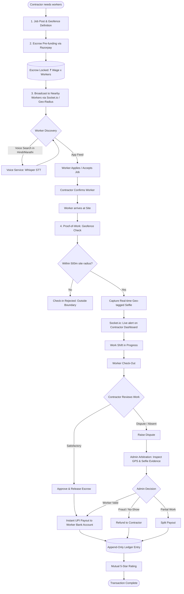
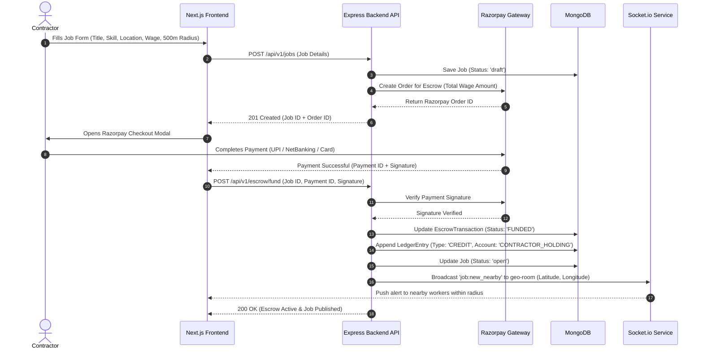
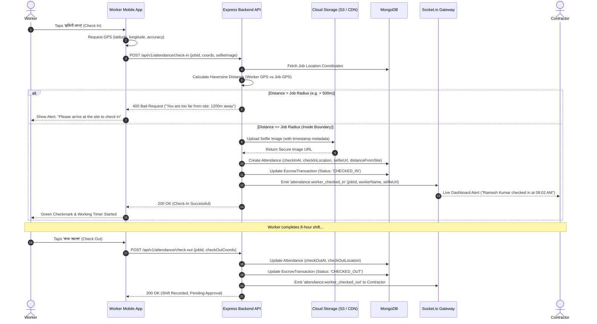
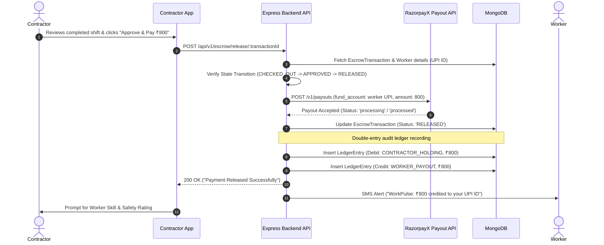
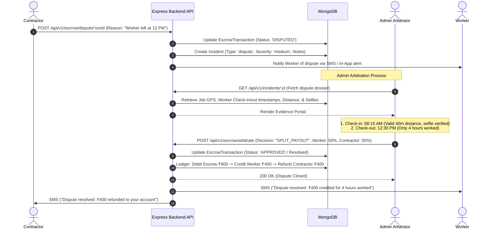
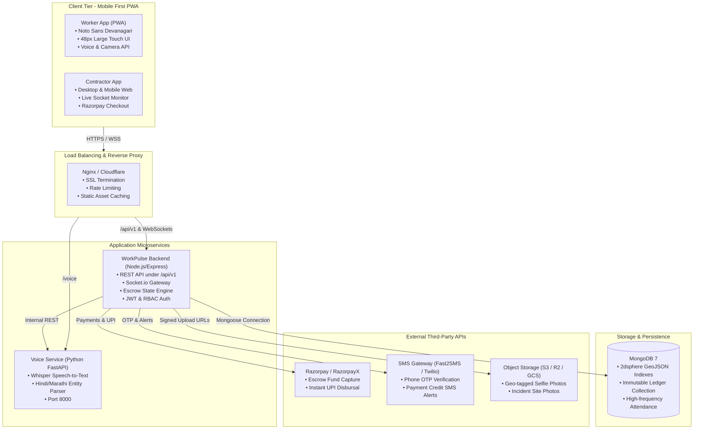

# WorkPulse – Complete Workflows & Sequence Diagrams

---

## 1. End-to-End Master Lifecycle Workflow

This flowchart illustrates the complete lifecycle of a job—from contractor creation and escrow deposit to worker matching, GPS proof-of-work, and instant UPI payout.

---

## 2. Sequence Diagram 1: Job Posting & Escrow Funding

Shows the interaction between Contractor, Frontend, Backend, Razorpay, and MongoDB to lock escrow before broadcasting.

---

## 3. Sequence Diagram 2: Proof-of-Work Attendance (Check-In & Check-Out)

Shows how geolocation coordinates and selfie photo prevent proxy attendance and fake check-ins.

---

## 4. Sequence Diagram 3: Escrow Approval & Instant UPI Payout

The happy path where the contractor approves the work, triggering instant payout via UPI and recording double-entry ledger entries.

---

## 5. Sequence Diagram 4: Dispute & Admin Arbitration (Unhappy Path)

When there is a disagreement (e.g., worker left early or contractor refuses to approve), this flow guides arbitration.

---

## 6. Voice Search & Skill Extraction Pipeline

The voice service flow allowing illiterate or semi-literate workers to speak naturally in Hindi or Marathi.

```mermaid
flowchart LR
    WorkerSpeech([Worker speaks:<br/>'मुझे कल 2 दिन के लिए<br/>मिस्त्री का काम चाहिए']) 
    --> Mic[Mobile Browser / App Audio Recorder]
    
    Mic -->|WAV Audio File| FastAPIService[POST /transcribe<br/>FastAPI Voice Service]
    
    FastAPIService --> Whisper[OpenAI Whisper Engine]
    Whisper -->|Transcribed Text: Hindi/Marathi| NLP[Skill Extraction NLP Model]
    
    NLP -->|Extract Entities| JSONResult["Extracted JSON:<br/>{ skill: 'mason',<br/>duration_days: 2,<br/>language: 'hi' }"]
    
    JSONResult --> BackendQuery[Express API /api/v1/jobs]
    BackendQuery --> MongoNear[MongoDB 2dsphere $near query<br/>skill == 'mason' & status == 'open']
    
    MongoNear --> AudioCard[Render Simplified Visual Audio Job Cards]
    AudioCard --> WorkerDevice([Worker hears results & clicks to Apply])
```

---

## 7. Complete System Architecture & Network Topology

How all services, databases, and third-party gateways communicate across the deployment topology.

