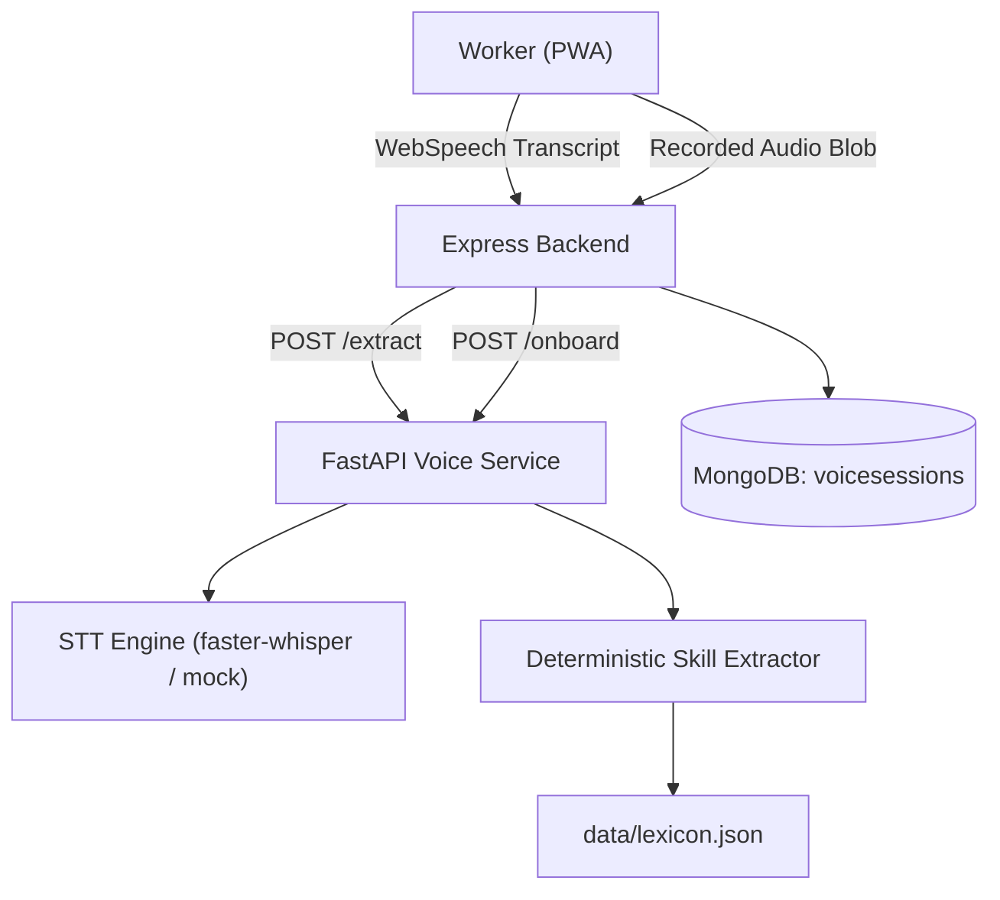

# WorkPulse Voice Service Specification & Documentation

## 1. Overview & Architecture

The WorkPulse Voice Service (`voice-service/`) is an autonomous, high-efficiency Python FastAPI service designed to handle speech-to-text (STT) transcription and multilingual skill & experience extraction for blue-collar Indian workers.

The service is strictly internal—it is called exclusively by the `backend` Express service via the shared secret header `X-Internal-Key`. Web browsers never interact with this service directly.



---

## 2. STT Providers & Selection Strategy

The STT layer (`app/services/stt_service.py`) implements a unified provider interface governed by `STT_PROVIDER`:

| Provider | Production Suitability | Dependencies | Use Case |
|---|---|---|---|
| `mock` | Local Dev & CI Testing | None (Pure Python) | Default. Returns `mockTranscript` or a fixed sample sentence. Needs no models or GPUs. |
| `faster_whisper` | Self-Hosted Production | `faster-whisper>=1.0.0` (in `requirements-whisper.txt`) | Offline, privacy-first transcription. Runs `base` or `small` int8 model on CPU/CUDA with VAD filter, beam size 5, and trade vocabulary bias prompt. Lazy loaded on first request. |
| `openai` | Cloud Managed | `httpx` (HTTP POST) | Cloud alternative using Whisper API (`whisper-1`). High accuracy across Indian accents, paid per minute. |

### Configuration (`core/config.py` & `.env`)
```bash
STT_PROVIDER=mock
WHISPER_MODEL=base
WHISPER_DEVICE=cpu
WHISPER_COMPUTE_TYPE=int8
STT_CONCURRENCY=1
STT_TIMEOUT_SEC=60
MAX_AUDIO_BYTES=5242880
MAX_AUDIO_SECONDS=30
INTERNAL_API_KEY=workpulse-internal-voice-key-2026
ALLOWED_ORIGINS=http://localhost:5000
LOG_TRANSCRIPTS=false
```

### Critical Whisper Settings & Optimizations
1. **Forced Language**: When the user picks Hindi, Marathi, or English, the language parameter is **explicitly forced**. It is NEVER set to auto-detect, as Whisper models frequently misclassify spoken Hindi as Urdu.
2. **Trade Vocabulary Prompt**: Initial prompt injects common trade words (`painter`, `plumber`, `electrician`, `mistri`, `raj mistri`, `majdoor`, `beldar`, `badhai`, `rang`, `bijli`, `nal`, `saal`, `experience`) to bias beam search.
3. **Silence & Hallucination Filter**: Short audio segments producing known Whisper silence hallucinations (`"thank you for watching"`, `"subscribe"`, `"you"`) or empty transcripts are rejected with `422 NO_SPEECH_DETECTED`.

---

## 3. Skill & Experience Extractor

The extractor (`app/services/skill_extractor.py`) is **pure Python, deterministic, offline, and testable**. It uses no large language models (LLM-based extraction is earmarked as future work), ensuring zero GPU overhead and predictable behavior.

### 3.1 Lexicon Structure (`data/lexicon.json`)
The lexicon covers all 16 canonical skills in the backend enum:
```json
{
  "skills": {
    "painter": {
      "synonyms": {
        "hi_deva": ["पेंटर", "पेंट", "रंगाई", "पुताई"],
        "mr_deva": ["रंगारी", "रंगकाम", "पेंटर"],
        "roman": ["painter", "penter", "paint", "rang", "rangrez", "rangai", "putai"],
        "en": ["painter", "painting", "wall painter"]
      },
      "weight": 1.0
    }
  }
}
```

### 3.2 How to Add a Synonym, Skill, or Language
1. **Add a Synonym**: Open `data/lexicon.json`, find the target skill key, and append the synonym to the corresponding list (`hi_deva`, `mr_deva`, `roman`, or `en`).
2. **Add a New Skill**:
   - Add the skill key to `backend/src/config/constants.js` `SKILLS` array.
   - Add the key, labels, and icon to `backend/src/config/skills.catalog.js`.
   - Add the entry in `voice-service/app/data/lexicon.json` with multi-script synonyms.
3. **Add a New Language**:
   - Add the new script dictionary key (e.g. `bn_deva`, `te_script`) in `lexicon.json`.
   - Update `app/services/skill_extractor.py` character transliteration / digit normalization.

### 3.3 Normalization Pipeline
Before tokenization, text undergoes strict normalization in `normalize()`:
- Unicode NFC normalization.
- Lowercase conversion.
- Stripping zero-width joiners (`\u200c`, `\u200d`) and punctuation.
- Removing Nukta (`\u093c` and precomposed characters `ज़`->`ज`, `ड़`->`ड`, `फ़`->`फ`).
- Chandrabindu normalization to anusvara (`ँ`->`ं`).
- Collapsing repeated Roman characters (`paaainter` -> `painter`).
- Normalizing Devanagari digits (`०-९`) to ASCII `0-9`.

### 3.4 Extraction Rules & Confidence
- **Compound Phrases (Priority 1)**: Longest-match greedy consumption. `"raj mistri"` -> `mason`, `"bijli mistri"` -> `electrician`, `"nal mistri"` -> `plumber`.
- **Ambiguous Mistri**: A bare `"mistri"` or `"मिस्त्री"` without qualifying trade is assigned `mason` with confidence `0.5` (routed to suggestions in the UI, not pre-selected) and tagged with flag `AMBIGUOUS_MISTRI`.
- **Exact Matches**: Confidence `0.95`.
- **Fuzzy Matching**: Matches via `difflib.SequenceMatcher` ratio $\ge 0.84$ on tokens with length $\ge 4$ receive confidence $\text{ratio} \times 0.9$.
- **Negation Handling**: If a skill token is followed within 2 tokens by a negation marker (`nahi`, `nahin`, `nai`, `नहीं`, `नाही`, `not`, `no`), the skill is excluded and flagged `NEGATED_SKILL_REMOVED`. Positive-after-negative patterns (`"plumber nahi, painter hoon"`) resolve to `painter` only.
- **Experience Parsing**:
  - Digits (ASCII and Devanagari) or number words (`paanch`, `panch`, `पाँच`, `दस`, `ten`, etc.) for 0-50 followed/preceded by year units (`saal`, `sal`, `varsh`, `varshe`, `वर्ष`, `years`, `yrs`).
  - Months (`mahine`, `महीने`) are converted as $\lfloor \text{months}/12 \rfloor$ and flagged `EXPERIENCE_UNDER_ONE_YEAR` when $<12$.
  - `"fresher"`, `"naya hoon"`, `"koi experience nahi"`, `"अनुभव नाही"` resolve to `0`.
  - Cap at 50 years.

---

## 4. Evaluation Method & Golden Set Benchmark

To evaluate skill and experience extraction deterministically, `voice-service/tests/data/utterances.json` contains **55 hand-written utterances** spanning Hindi (Devanagari), Roman Hinglish, Marathi, and English.

Run the evaluation script via:
```bash
python -m app.scripts.eval_extractor
```

### Verified Benchmark Output
```text
================================================================================
EVALUATION REPORT: SKILL & EXPERIENCE EXTRACTOR
================================================================================
Total Utterances: 55
Skills Exact Match Accuracy: 100.0% (55 / 55)
Experience Years Accuracy:   100.0% (55 / 55)

Language Breakdown:
  Hindi (Devanagari):  100.0% skills, 100.0% years (15 utterances)
  Roman Hinglish:      100.0% skills, 100.0% years (17 utterances)
  Marathi (Devanagari):100.0% skills, 100.0% years (13 utterances)
  English:             100.0% skills, 100.0% years (10 utterances)
================================================================================
```

---

## 5. Honest Limitations & Architectural Trade-offs

1. **Synthetic Golden Set**: The current benchmark set is synthetic and hand-written, not field-recorded construction worker audio. Real acoustic field data with ambient site noise will require ongoing lexicon calibration.
2. **Whisper Marathi Accuracy**: Public Whisper models (`base` and `small`) perform notably worse on spoken Marathi compared to Hindi or English, with occasional hallucinations. The Marathi consent screen explicitly recommends speaking slowly and verifying chips.
3. **Web Speech API & Google Servers**: Chrome's Web Speech API transmits audio to Google's cloud servers for transcription. This is disclosed to workers on the DPDP consent screen.
4. **Noisy Construction Sites**: Acoustic noise (generators, drills) can cause silence timeouts or truncated speech. The 16-skill icon grid is guaranteed as an immediate zero-friction fallback.

---

## 6. Privacy & DPDP Act 2023 Compliance

1. **Zero Audio Storage**: Under no circumstances is audio written to disk, databases, or object stores. It is decoded directly in memory and discarded upon completion.
2. **Draft Isolation**: Extracted skills are DRAFTS. Only `/voice/confirm` modifies the worker profile.
3. **Transcript TTL**: Recognized transcripts are stored in `voicesessions` and automatically purged after 90 days via MongoDB TTL index.
4. **Consent Versioning**: Every session records `consentAt` timestamp and `consentVersion: "v1"`.
