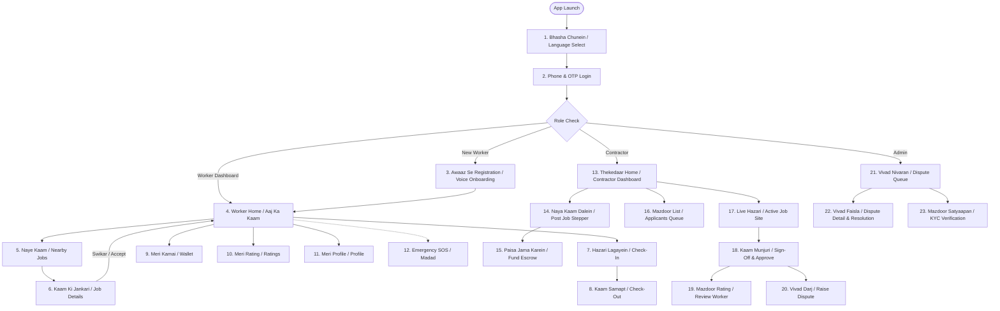

# WorkPulse Mobile-First UI/UX Wireframes & Screen Specifications

**Target Device Viewport**: 360px width (Mobile-First, Android entry-level smartphone)  
**Primary Design Principle**: High-contrast, audio/icon-first, Hindi-primary with English subtitles, minimum 48px tactile touch targets.

---

## 1. Global Navigation Architecture



---

## 2. Design System & Accessibility Baseline

| Element | Specification | Rationale & Contrast |
| :--- | :--- | :--- |
| **Primary Color** | Deep Indigo `#1E3A8A` (Dark) / `#3B82F6` (Action) | Contrast 8.4:1 on white. Clear visibility under direct sun. |
| **Accent / Currency** | Emerald Green `#059669` | Standard color for money credit & successful check-in. |
| **Emergency / Alert** | Vivid Crimson `#DC2626` | SOS & Dispute. High contrast 4.8:1 on dark surfaces. |
| **Minimum Tap Target** | 48px × 48px (with 8px padding) | Accessible for workers with dust/calloused fingers. |
| **Typography** | `Inter`, `Noto Sans Devanagari` (16px base, 20px header) | Clear legibility in Hindi and Marathi scripts. |
| **Network Resilience** | Offline caching with IndexedDB + Service Worker | Offline banner with local timestamp verification. |

---

## 3. Worker Screen Specifications

### Screen W1: Language Select (भाषा चुनें)
- **Purpose**: First screen on fresh install to pick mother tongue.
- **Icons**: `Globe`, `CheckCircle2`
- **API Call**: `PATCH /users/profile` (or stored locally in `localStorage`)

```text
+----------------------------------+
| [Globe] WorkPulse                |
|                                  |
|     अपनी भाषा चुनें              |
|     (Choose your Language)       |
|                                  |
| +------------------------------+ |
| | [Check] हिंदी (Hindi)        | | (Active: 54px height)
| +------------------------------+ |
|                                  |
| +------------------------------+ |
| |         मराठी (Marathi)      | |
| +------------------------------+ |
|                                  |
| +------------------------------+ |
| |         English              | |
| +------------------------------+ |
|                                  |
| +------------------------------+ |
| | [ArrowRight] आगे बढ़ें (Next)| | (Primary Button 50px)
| +------------------------------+ |
+----------------------------------+
```

---

### Screen W2: Phone + OTP Login (लॉगिन)
- **Purpose**: Frictionless passwordless login via mobile number.
- **Icons**: `Phone`, `ShieldCheck`, `ArrowRight`, `RotateCcw`
- **API Calls**: `POST /auth/send-otp`, `POST /auth/verify-otp`

```text
+----------------------------------+
| [ArrowLeft]                      |
|                                  |
|     मोबाइल नंबर डालें             |
|     (Enter Mobile Number)        |
|                                  |
| +------------------------------+ |
| | [Phone] +91 | 98765 43210    | |
| +------------------------------+ |
|                                  |
| +------------------------------+ |
| | [Shield] OTP भेजें (Send OTP)| |
| +------------------------------+ |
|                                  |
|   OTP दर्ज करें (Enter OTP):     |
|   [ 4 ] [ 8 ] [ 2 ] [ 9 ]        |
|                                  |
|   [RotateCcw] दोबारा भेजें (0:45) |
|                                  |
| +------------------------------+ |
| | [Check] पुष्टि करें (Verify) | |
| +------------------------------+ |
+----------------------------------+
```

---

### Screen W3: Voice Onboarding (आवाज़ से रजिस्ट्रेशन)
- **Purpose**: Rapid worker profile creation speaking naturally in native tongue.
- **Icons**: `Mic`, `Volume2`, `Wrench`, `Sparkles`, `Hammer`
- **API Calls**: `POST /voice/onboard`, `PATCH /users/profile`

```text
+----------------------------------+
| [Sparkles] बोलकर बताएं           |
| (Speak your skills & experience) |
|                                  |
|        +---------------+         |
|        |               |         |
|        |     [Mic]     |         | (Pulsing Red Circle)
|        |  (बोलें...)   |         | (80px x 80px Target)
|        |               |         |
|        +---------------+         |
|                                  |
| "मेरा नाम रमेश है, मैं 5 साल से  |
|  मिस्त्री का काम करता हूँ..."    |
|                                  |
| -------------------------------- |
| या नीचे चुने (Or select skill):  |
| [Hammer] राजमिस्त्री [Wrench] प्लंबर|
| [Paintbrush] पेंटर   [Zap] इलेक्ट्रीशियन|
|                                  |
| +------------------------------+ |
| | [Check] प्रोफाइल सेव करें    | |
| +------------------------------+ |
+----------------------------------+
```

---

### Screen W4: Worker Home Dashboard (आज का काम)
- **Purpose**: Instant glance at today's committed shift, wallet balance, and nearby opportunities.
- **Icons**: `Calendar`, `IndianRupee`, `MapPin`, `AlertOctagon`, `Clock`
- **API Calls**: `GET /jobs/nearby`, `GET /wallets/me`, `GET /attendance/today`

```text
+----------------------------------+
| [User] रमेश कुमार  [₹ 2,400]    |
| ================================ |
| आज का काम (Today's Scheduled Job)|
| +------------------------------+ |
| | [Building] दीवार निर्माण     | |
| | [Clock] 09:00 AM - 06:00 PM  | |
| | [IndianRupee] ₹ 850 (सुरक्षित) | |
| | [MapPin] हिंजेवाड़ी (1.2 km)   | |
| |                              | |
| | +--------------------------+ | |
| | | [Camera] हाज़िरी लगाएं    | | | (High priority green)
| | +--------------------------+ | |
| +------------------------------+ |
|                                  |
| [AlertOctagon] आपातकालीन SOS     | (Red Bar 48px)
|                                  |
| [Home]     [Briefcase]   [Wallet]|
+----------------------------------+
```

---

### Screen W5: Check-in Screen (हाज़िरी दर्ज करें)
- **Purpose**: Geofenced GPS validation with camera selfie for tamper-proof proof-of-work.
- **Icons**: `MapPin`, `Camera`, `CheckCircle2`, `Crosshair`
- **API Call**: `POST /attendance/check-in`

```text
+----------------------------------+
| [ArrowLeft] काम पर आगमन (Check-in)|
|                                  |
|  लोकेशन दूरी (Site Distance):    |
|  [MapPin] 24 मीटर दूर (मान्य)    |
|  =============================== |
|  [     MINI GPS MAP PREVIEW    ] |
|  [     (Green Geofence Circle) ] |
|  =============================== |
|                                  |
|  सेल्फी फोटो लें (Take Selfie):  |
|  +-----------------------------+ |
|  |                             | |
|  |          [Camera]           | |
|  |     चेहरा फ्रेम में रखें    | |
|  |                             | |
|  +-----------------------------+ |
|                                  |
| +------------------------------+ |
| | [Check] हाज़िरी पक्की करें   | | (Green 50px)
| +------------------------------+ |
+----------------------------------+
```

---

### Screen W6: Worker Wallet (मेरी कमाई)
- **Purpose**: Direct view of escrow releases, withdrawable funds, and UPI linking.
- **Icons**: `IndianRupee`, `ArrowDownLeft`, `ArrowUpRight`, `Lock`
- **API Calls**: `GET /wallets/me`, `GET /wallets/ledger`

```text
+----------------------------------+
| [ArrowLeft] मेरी कमाई (Wallet)   |
|                                  |
|  उपलब्ध बैलेंस (Available Cash)  |
|  ₹ 2,400.00                      |
|  [Lock] एस्क्रो में: ₹ 850.00     |
|                                  |
|  UPI ID: ramesh@oksbi [Edit]     |
|                                  |
| लेनदेन इतिहास (Transaction Log): |
| +------------------------------+ |
| | [ArrowDownLeft] +₹ 850 (क्रेडिट)| |
| | दीवार निर्माण - 18 Oct 2026  | |
| +------------------------------+ |
| | [ArrowDownLeft] +₹ 800 (क्रेडिट)| |
| | प्लास्टर काम - 17 Oct 2026   | |
| +------------------------------+ |
+----------------------------------+
```

---

## 4. Contractor Screen Specifications

### Screen C1: Post Job Stepper (नया काम डालें)
- **Purpose**: 5-step rapid job creation workflow with direct map pin placement.
- **Icons**: `Hammer`, `Users`, `IndianRupee`, `Calendar`, `MapPin`
- **API Call**: `POST /jobs`

```text
+----------------------------------+
| [ArrowLeft] नया काम (Post Job)   |
| Step 1/4: काम का प्रकार चुनें    |
|                                  |
| +--------------+ +-------------+ |
| | [Hammer]     | | [Paint]     | |
| | मिस्त्री     | | पेंटर       | |
| +--------------+ +-------------+ |
| +--------------+ +-------------+ |
| | [Wrench]     | | [Zap]       | |
| | प्लंबर       | | इलेक्ट्रीशियन| |
| +--------------+ +-------------+ |
|                                  |
| कारीगर संख्या: [-] 3 [+]         |
| रोज़ाना दिहाड़ी (₹): [ 850 ]     |
| तारीख: 20 Oct 2026 (3 दिन)       |
|                                  |
| [MapPin] साइट लोकेशन सेट करें    |
| [Next] आगे बढ़ें (Fund Escrow)   |
+----------------------------------+
```

---

### Screen C2: Fund Escrow Screen (पैसा एस्क्रो में जमा करें)
- **Purpose**: Lock daily worker wages via Razorpay test gateway prior to shift.
- **Icons**: `ShieldCheck`, `CreditCard`, `Lock`
- **API Calls**: `POST /escrow/create-order`, `POST /escrow/verify-payment`

```text
+----------------------------------+
| [ArrowLeft] एस्क्रो सुरक्षा      |
| (Lock Wages in Escrow)           |
|                                  |
| 3 कारीगर x 1 दिन x ₹ 850         |
| कुल सुरक्षित राशि (Total):       |
| ₹ 2,550.00                       |
|                                  |
| [ShieldCheck] गारंटी:            |
| हाज़िरी होने और काम पूरा होने पर |
| ही पैसा रिलीज़ होगा।             |
|                                  |
| +------------------------------+ |
| | [CreditCard] Razorpay से भरें| |
| +------------------------------+ |
+----------------------------------+
```

---

### Screen C3: Active Job Site & Live Attendance (साइट उपस्थिति)
- **Purpose**: Real-time attendance verification for assigned workers.
- **Icons**: `Users`, `CheckCircle2`, `Clock`, `AlertTriangle`
- **API Calls**: `GET /jobs/:id/attendance`, `POST /attendance/:id/signoff`

```text
+----------------------------------+
| [Building] Hinjawadi Wall Project|
| 20 Oct 2026 | 3/3 कारीगर उपस्थित |
| ================================ |
|                                  |
| +------------------------------+ |
| | [Photo] रमेश कुमार (मिस्त्री)| |
| | [Clock] 08:58 AM Check-in    | |
| | [Check] GPS: 24m (OK)        | |
| | [Button: काम मंज़ूर करें]    | | (Approve ₹850)
| | [Button: विवाद दर्ज करें]    | | (Dispute)
| +------------------------------+ |
|                                  |
| +------------------------------+ |
| | [Photo] सुरेश यादव (मिस्त्री)| |
| | [Clock] 09:02 AM Check-in    | |
| | [Check] GPS: 18m (OK)        | |
| | [Button: काम मंज़ूर करें]    | |
| +------------------------------+ |
+----------------------------------+
```

---

## 5. Admin Screen Specifications

### Screen A1: Dispute Resolution Queue (विवाद निवारण)
- **Purpose**: Central arbitration triage list for contested escrow transactions.
- **Icons**: `Scale`, `AlertCircle`, `Filter`, `Clock`
- **API Call**: `GET /admin/disputes`

```text
+----------------------------------+
| [Scale] WorkPulse Admin Tribunal |
| Active Disputes: 4 Pending       |
| ================================ |
|                                  |
| +------------------------------+ |
| | Case #DSP-104 | ₹ 850        | |
| | Thekedaar: M/s Sharma Build  | |
| | Mazdoor: Ramesh Kumar        | |
| | Reason: WORK_QUALITY         | |
| | [Clock] 4 hours remaining    | |
| | [Review Evidence ->]         | |
| +------------------------------+ |
+----------------------------------+
```

---

### Screen A2: Dispute Evidence & Resolution (विवाद फैसला)
- **Purpose**: Compare worker selfie/GPS proof with contractor complaint and issue binding split.
- **Icons**: `MapPin`, `Image`, `FileText`, `CheckCircle2`
- **API Call**: `POST /admin/disputes/:id/resolve`

```text
+----------------------------------+
| [ArrowLeft] Case #DSP-104 Detail |
|                                  |
| सबूत (Evidence Submitted):       |
| - GPS: Check-in 24m, Out 32m OK  |
| - Photo: Completed wall attached |
| - Complaint: "Mortar ratio thin" |
|                                  |
| फैसला चुने (Select Decision):    |
| ( ) कारीगर को पूरा दें (₹ 850)   |
| ( ) ठेकेदार को रिफंड (₹ 850)     |
| (*) 50/50 स्प्लिट (₹ 425 / ₹ 425)|
|                                  |
| +------------------------------+ |
| | [Check] अंतिम निर्णय लागू करें| |
| +------------------------------+ |
+----------------------------------+
```

---

## Phase 6: Voice Onboarding Wireframes

### Screen V1: Language Selection (अपनी भाषा चुनें)
- **Route**: `/worker/onboarding` (Step 1)
- **Purpose**: First screen for new workers to set their native tongue.
- **Components**: 3 large selection cards (Hindi, Marathi, English).

```text
+----------------------------------+
| WP WorkPulse              (● ○ ○)|
|                                  |
|         [Globe Icon]             |
|       अपनी भाषा चुनें            |
|     Choose Your Language         |
|                                  |
| +------------------------------+ |
| | हिंदी (Hindi)                | |
| | दैनिक काम और हाज़िरी         | |
| +------------------------------+ |
|                                  |
| +------------------------------+ |
| | मराठी (Marathi)              | |
| | दैनिक काम आणि हजेरी          | |
| +------------------------------+ |
|                                  |
| +------------------------------+ |
| | English                      | |
| | Daily work & attendance      | |
| +------------------------------+ |
+----------------------------------+
```

---

### Screen V2: DPDP Voice Consent (आवाज़ की अनुमति)
- **Route**: `/worker/onboarding` (Step 2)
- **Purpose**: Compliant DPDP Act 2023 consent informing worker that voice is used only for skills and never stored.
- **Components**: Shield banner, explicit privacy guarantees, Accept & Speak button, Use Icons button.

```text
+----------------------------------+
| WP WorkPulse              (● ● ○)|
|                                  |
|       [ShieldCheck Icon]         |
|       आवाज़ की अनुमति            |
|       Voice Consent (DPDP)       |
|                                  |
| आपकी आवाज़ का उपयोग केवल आपके    |
| हुनर और अनुभव को समझने के लिए    |
| किया जाता है।                    |
|                                  |
| [✓] ऑडियो कभी भी सेव नहीं होगा   |
| [✓] केवल आपके हुनर की पहचान होगी |
|                                  |
| +------------------------------+ |
| | [Check] ठीक है, बोलकर बताएं  | |
| +------------------------------+ |
|                                  |
| +------------------------------+ |
| | नहीं, आइकन से चुनें           | |
| +------------------------------+ |
+----------------------------------+
```

---

### Screen V3: Speak Your Trade (बोलकर बताएं)
- **Route**: `/worker/onboarding` (Step 3)
- **Purpose**: Primary voice input with huge 96px mic button, audio level meter, live transcript, sample prompt.
- **Components**: 96px pulsating Mic button, Audio level ring, Listen sample button, Dev voice tools.

```text
+----------------------------------+
| WP WorkPulse              (● ● ●)|
|                                  |
|         बोलकर बताएं              |
|   माइक दबाएं और अपना काम बोलें   |
|                                  |
| +------------------------------+ |
| | उदाहरण: "मैं पेंटर हूँ,      | |
| | 5 साल का अनुभव है"  [Volume] | |
| +------------------------------+ |
|                                  |
|             ((   ))              |
|          +---------+             |
|          |  [MIC]  |             |
|          |  (96px) |             |
|          +---------+             |
|             ((   ))              |
|                                  |
|      "सुन रहे हैं... बोलिए"      |
|    "main painter hoon..."        |
|                                  |
| [Dusre tareeke se bolein]        |
| • [Icon se chunein]              |
|                                  |
| [▼ 🧪 Dev voice tools]          |
| - Type: [main painter hoon] [Run]|
| - 1-Tap Golden Samples           |
+----------------------------------+
```

---

### Screen V4: Confirm Detected Skills (जांचें और पुष्टि करें)
- **Route**: `/worker/onboarding` (Step 4)
- **Purpose**: Review extracted draft skills, suggestions, adjust experience years with +/- stepper, speaker readback.
- **API Call**: `POST /voice/confirm`

```text
+----------------------------------+
| WP WorkPulse              (● ● ●)|
|                                  |
| जांचें और पुष्टि करें  [Volume]  |
|                                  |
| पहचाने गए हुनर (Detected):       |
| +-----------------+              |
| | [Paint] पेंटर ✓ |              |
| +-----------------+              |
|                                  |
| क्या आप यह भी हैं? (Suggestions):|
| +---------------+                |
| | [Hammer] मिस्त्री + |          |
| +---------------+                |
| [+ और हुनर जोड़ें]               |
|                                  |
| काम का अनुभव (Experience):       |
|       [-]   5 वर्ष   [+]         |
|                                  |
| जो हमने सुना (Transcript):       |
| [main painter hoon 5 saal] [Re]  |
|                                  |
| +------------------------------+ |
| | [Check] सही है, सेव करें     | |
| +------------------------------+ |
|          [दोबारा बोलें]          |
+----------------------------------+
```

---

### Screen V5: Icon Grid Fallback (आइकन से चुनें)
- **Route**: `/worker/onboarding` (Step 5)
- **Purpose**: Universal guaranteed fallback when voice fails, mic is denied, or user prefers icons.
- **Components**: 16-skill grid with Lucide icons, experience stepper, Confirm button.

```text
+----------------------------------+
| WP WorkPulse              (● ● ●)|
|                                  |
|         अपना हुनर चुनें          |
|   नीचे दिए गए आइकन से काम चुनें  |
|                                  |
| [Paint] पेंटर      [Wrench] प्लंबर|
| [Zap] इलेक्ट्रीशियन [Hammer] मिस्त्री|
| [Hammer] बढ़ई      [Help] हेल्पर  |
| [HardHat] मजदूर    [Sparkles]वेल्डर|
| [Layers] टाइल      [Truck] ड्राइवर|
|                                  |
| अनुभव (Experience): [-] 3 yr [+] |
|                                  |
| +------------------------------+ |
| | [Check] सही है, सेव करें     | |
| +------------------------------+ |
+----------------------------------+
```

